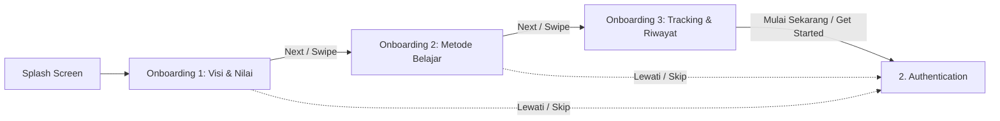

# 1. Onboarding Page

---

## 1. Description
Halaman Onboarding adalah titik sentuh pertama (*first touchpoint*) ketika pengguna pertama kali membuka aplikasi Celoteh setelah *Splash Screen*. Modul ini bertujuan memperkenalkan *value proposition* utama Celoteh sebagai aplikasi pendamping stimulasi perkembangan bahasa anak di rumah, membangun empati dan rasa aman bagi orang tua, serta mengarahkan mereka secara mulus menuju proses registrasi akun.

---

## 2. Goals & UX Metrics
* **Goal Utama:** 
  * Mengedukasi orang tua bahwa Celoteh adalah sarana stimulasi terstruktur, menyenangkan, dan aman di rumah.
  * Menjelaskan 3 pilar fitur inti aplikasi secara visual: *Learning Material* (Belajar Interaktif), *Voice Recording* (Latihan Suara), dan *Progress Tracking* (Pemantauan Perkembangan).
  * Membangun kepercayaan orang tua dengan menegaskan pendekatan pendampingan positif tanpa klaim diagnosis medis yang menakutkan.
* **UX Metrics:**
  * **Onboarding Completion Rate:** $\ge 85\%$ pengguna menyelesaikan seluruh slide onboarding atau menekan tombol konversi ke registrasi.
  * **Drop-off Rate:** $< 10\%$ pada setiap perpindahan slide.

---

## 3. Constraints & Principles
* **First-Time Launch Only:** Onboarding hanya muncul saat pertama kali aplikasi diunduh dan dibuka. Status selesai disimpan pada *local storage/cache* perangkat sehingga saat pengguna membuka aplikasi berikutnya, langsung diarahkan ke layar *Authentication* atau *Dashboard*.
* **Skimmable & Empathetic:** Bahasa yang digunakan hangat, menenangkan, tidak menggunakan istilah medis atau jargon rumit (*child-friendly and parent-friendly language*).
* **Non-Medical Disclaimer:** Menegaskan peran aplikasi sebagai pendamping stimulasi di rumah, bukan pengganti terapis wicara profesional.
* **Control & Freedom:** Pengguna dapat berpindah antar slide secara fleksibel (*Swipe*, tombol *Next*, tombol *Previous*) dan memiliki opsi *Lewati (Skip)* untuk langsung menuju autentikasi.

---

## 4. User Flow

---

## 5. UI Flow & Spesifikasi Komponen

### Top Navigation Bar (Semua Slide Onboarding)
* **Tombol "Lewati" (Skip):** Terletak di sudut kanan atas (pada Slide 1 dan Slide 2) yang langsung mengarahkan pengguna ke Halaman Registrasi / Login.

---

### Onboarding Slide 1: Pengenalan Nilai Emosional
* **Ilustrasi:** Karakter orang tua dan anak sedang berinteraksi hangat sambil memegang buku bergambar dengan maskot Celoteh.
* **Judul (Headline):** *"Setiap Suara Punya Cerita"*
* **Deskripsi (Subhead):** *"Dampingi perjalanan komunikasi si kecil melalui aktivitas belajar bicara yang terarah dan menyenangkan bersama Celoteh."*
* **Komponen Navigasi Bawah:**
  * **Page Indicator Dots:** 3 titik status aktif (Titik 1 aktif / highlight warna primer).
  * **Tombol "Lanjut" (Next):** Mengarahkan ke Slide 2.

---

### Onboarding Slide 2: Pengenalan Metode Sesi Belajar Interaktif
* **Ilustrasi:** Anak dengan gembira berbicara di depan mikrofon interaktif dengan visual gelombang suara warna-warni dan elemen bintang.
* **Judul (Headline):** *"Belajar, Tirukan, dan Rayakan"*
* **Deskripsi (Subhead):** *"Ajak si kecil mengenal kata baru lewat visual ceria, latihan suara interaktif, dan apresiasi positif di setiap langkahnya."*
* **Komponen Navigasi Bawah:**
  * **Tombol "Kembali" (Back / Previous icon):** Kembali ke Slide 1.
  * **Page Indicator Dots:** Titik 2 aktif.
  * **Tombol "Lanjut" (Next):** Mengarahkan ke Slide 3.

---

### Onboarding Slide 3: Pengenalan Dokumentasi & Pemantauan Progres
* **Ilustrasi:** Orang tua tersenyum melihat grafik perkembangan anak di ponsel dengan ikon rekaman suara dan lencana prestasi.
* **Judul (Headline):** *"Setiap Langkah Kecil Begitu Berarti"*
* **Deskripsi (Subhead):** *"Pantau konsistensi latihan harian, dengarkan kembali rekaman suara si kecil, dan catat momen perkembangannya dengan mudah."*
* **Komponen Navigasi Bawah:**
  * **Tombol "Kembali" (Back / Previous icon):** Kembali ke Slide 2.
  * **Page Indicator Dots:** Titik 3 aktif.
  * **Tombol CTA Utama "Mulai Sekarang" (Primary CTA):** Tombol penuh yang menonjol, mengarahkan pengguna ke **2. Authentication (Pilihan Daftar / Masuk)**.
  * **Teks Sekunder:** *"Sudah punya akun? Masuk di sini"* (Direct link ke form login).

---

## 6. Hubungan dengan Modul Fitur Lain
* **Hubungan dengan PRD:** Mewujudkan pilar awal *Customer Journey* pada bagian Onboarding & Authentication.
* **Hubungan dengan `2. Authentication.md`:** 
  * Menekan tombol *"Mulai Sekarang"* membawa pengguna ke formulir Registrasi Akun baru.
  * Menekan link *"Masuk di sini"* atau *"Lewati"* membawa pengguna langsung ke formulir Login Akun.
* **Status Penyelesaian:** Saat pengguna melewati Onboarding (baik melalui tombol Mulai Sekarang atau Lewati), status `has_completed_onboarding = true` disimpan secara lokal di perangkat.
