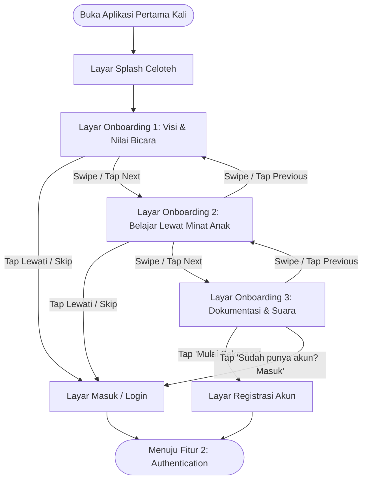

# 1. Onboarding Page

## Description
Halaman pengenalan yang ditampilkan ketika pengguna pertama kali membuka aplikasi Celoteh. Halaman ini bertujuan memperkenalkan fungsi utama aplikasi, manfaat stimulasi bicara berbasis minat anak, serta gambaran proses pembelajaran interaktif bersama orang tua.

## Goal
* Memperkenalkan Celoteh sebagai aplikasi pendamping stimulasi perkembangan bahasa dan komunikasi anak.
* Memberikan pemahaman mengenai fitur utama: Belajar Berbasis Minat, Rekaman Suara Interaktif, dan Progress Tracking.
* Menjelaskan peran orang tua dalam mendampingi aktivitas belajar anak di rumah.
* Membangun ketertarikan dan kepercayaan pengguna sebelum masuk ke aplikasi.
* Mengarahkan pengguna menuju halaman registrasi atau login.

## Constraint
* Onboarding ditampilkan ketika pengguna pertama kali membuka aplikasi.
* Pengguna dapat berpindah halaman menggunakan tombol Next, Previous, atau swipe layar.
* Terdapat opsi Lewati (Skip) bagi pengguna yang ingin langsung menuju login/register.
* Konten onboarding singkat, ramah, dan bebas istilah medis rumit.
* Onboarding menegaskan aplikasi sebagai pendamping stimulasi di rumah, bukan alat diagnosis medis.

## Flow
Onboarding Page 1 → Onboarding Page 2 → Onboarding Page 3 → Mulai Sekarang → Register / Login

## User Flow

### Rincian Langkah User Flow
1. **Titik Masuk (Entry Point):** Pengguna menginstal dan membuka aplikasi Celoteh untuk pertama kali.
2. **Jalur Utama / Happy Path:**
   * Pengguna melihat Slide 1 ("Setiap Suara Punya Cerita") $\rightarrow$ Mengetuk *Next* atau menggeser layar.
   * Pengguna melihat Slide 2 ("Belajar Lewat Minat Si Kecil") $\rightarrow$ Mengetuk *Next*.
   * Pengguna melihat Slide 3 ("Rayakan Setiap Langkah Kecil") $\rightarrow$ Mengetuk tombol utama *"Mulai Sekarang"*.
   * Pengguna diarahkan ke form pendaftaran akun baru (**2. Authentication**).
3. **Jalur Alternatif / Skip Path:**
   * Pada Slide 1 atau Slide 2, pengguna dapat mengetuk tombol *"Lewati"* di sudut kanan atas untuk langsung menuju halaman Login.
4. **Jalur Pengguna Terdaftar:**
   * Pada Slide 3, pengguna yang sudah memiliki akun dapat mengetuk link *"Sudah punya akun? Masuk"* untuk langsung membuka halaman Login.

## UI Flow
Onboarding Page 1
Ilustrasi anak dan orang tua sedang berinteraksi hangat bersama maskot.
Judul: "Setiap Suara Punya Cerita"
Deskripsi: "Dampingi perjalanan komunikasi si kecil melalui aktivitas belajar yang menyenangkan bersama Celoteh."
Indicator halaman onboarding.
Tombol Lewati (Skip) di sudut kanan atas.
Tombol Next.

Onboarding Page 2
Ilustrasi anak antusias belajar lewat hal favorit (hewan, kendaraan, buah).
Judul: "Belajar Lewat Minat Si Kecil"
Deskripsi: "Ajak si kecil berani bersuara melalui tema yang paling ia sukai dengan materi visual dan audio yang menyenangkan."
Indicator halaman onboarding.
Tombol Lewati (Skip) di sudut kanan atas.
Tombol Previous.
Tombol Next.

Onboarding Page 3
Ilustrasi orang tua melihat perkembangan rekaman suara anak di ponsel.
Judul: "Rayakan Setiap Langkah Kecil"
Deskripsi: "Pantau aktivitas belajar harian, simpan rekaman suara si kecil, dan bagikan ringkasan latihan ke terapis wicara."
Indicator halaman onboarding.
Tombol Previous.
Tombol Utama "Mulai Sekarang" (menuju Register).
Teks sekunder "Sudah punya akun? Masuk" (menuju Login).

## Hubungan Antar Fitur
* Menjadi pintu masuk awal pengguna baru sebelum diarahkan ke modul Authentication.
* Tombol "Mulai Sekarang" mengarahkan ke form Register, sedangkan tombol "Masuk" dan "Lewati" mengarahkan ke form Login.
