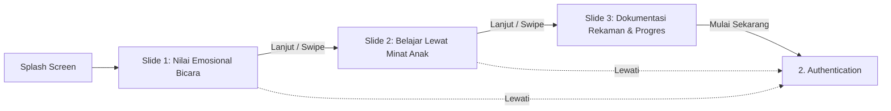

# 1. Onboarding Page

---

## 1. Description
Halaman Onboarding adalah layar pengenalan yang ditampilkan ketika pengguna pertama kali membuka aplikasi Celoteh setelah *Splash Screen*. Modul ini bertujuan memperkenalkan nilai utama Celoteh sebagai aplikasi stimulasi bicara anak berbasis minat yang menyenangkan dan terarah di rumah, serta mengarahkan orang tua menuju pembuatan akun atau masuk aplikasi.

---

## 2. Goals & UX Metrics
* **Goal Utama:**
  * Memperkenalkan Celoteh sebagai sahabat orang tua dalam menstimulasi bahasa anak melalui pendekatan minat dan interaksi suara.
  * Menampilkan 3 pilar fitur utama: Belajar Interaktif Berbasis Minat, Rekaman Suara Ramah Anak, dan Pemantauan Progres Bersama Terapis.
  * Membangun ketertarikan orang tua dengan antarmuka yang hangat, positif, dan mudah dipahami.
* **UX Metrics:**
  * **Completion Rate:** $\ge 85\%$ pengguna menyelesaikan slide onboarding hingga tombol aksi pendaftaran.
  * **Drop-off Rate:** $< 10\%$ pada setiap pergantian slide.

---

## 3. Constraints & Principles
* **Ringkas & Menarik:** Konten teks singkat dengan fokus pada ilustrasi emosional hubungan orang tua dan anak.
* **Bebas Tekanan:** Menekankan bahwa stimulasi bicara di rumah dilakukan dengan menyenangkan sesuai hal yang disukai anak, bukan keharusan kurikulum kaku.
* **Fleksibilitas Navigasi:** Pengguna dapat berpindah halaman (*swipe*, tombol *Lanjut*, tombol *Kembali*) dan disediakan opsi tombol *Lewati (Skip)* untuk langsung menuju autentikasi.

---

## 4. User Flow

---

## 5. UI Flow & Spesifikasi Komponen

### Top Navigation Bar
* **Tombol "Lewati" (Skip):** Terletak di sudut kanan atas pada Slide 1 dan Slide 2, mengarahkan pengguna langsung ke Halaman Masuk / Daftar.

---

### Onboarding Slide 1: Pendampingan Komunikasi yang Menyenangkan
* **Ilustrasi:** Orang tua dan anak sedang bercengkrama gembira bersama maskot Celoteh.
* **Judul (Headline):** *"Setiap Suara Punya Cerita"*
* **Deskripsi (Subhead):** *"Dampingi perjalanan komunikasi si kecil melalui aktivitas stimulasi bicara yang terarah dan menyenangkan di rumah."*
* **Komponen Bawah:**
  * **Page Indicator Dots:** 3 titik status (Titik 1 aktif).
  * **Tombol "Lanjut":** Mengarahkan ke Slide 2.

---

### Onboarding Slide 2: Belajar Bicara Lewat Hal yang Disukai Anak
* **Ilustrasi:** Anak gembira menunjuk berbagai tema favorit (hewan lucu, mobil, dan buah-buahan) sambil bersuara ke mikrofon.
* **Judul (Headline):** *"Belajar Lewat Minat Si Kecil"*
* **Deskripsi (Subhead):** *"Ajak si kecil berani bersuara melalui tema yang paling ia sukai—mulai dari hewan lucu, kendaraan, hingga makanan favorit."*
* **Komponen Bawah:**
  * **Tombol "Kembali":** Kembali ke Slide 1.
  * **Page Indicator Dots:** Titik 2 aktif.
  * **Tombol "Lanjut":** Mengarahkan ke Slide 3.

---

### Onboarding Slide 3: Simpan Suara & Pantau Perkembangan
* **Ilustrasi:** Orang tua melihat riwayat suara anak di ponsel dengan visual grafik ceria dan lencana pencapaian.
* **Judul (Headline):** *"Rayakan Setiap Langkah Kecil"*
* **Deskripsi (Subhead):** *"Dengarkan kembali rekaman suara si kecil, catat perkembangan hariannya, dan bagikan ringkasan latihan ke terapis wicara."*
* **Komponen Bawah:**
  * **Tombol "Kembali":** Kembali ke Slide 2.
  * **Page Indicator Dots:** Titik 3 aktif.
  * **Tombol CTA Utama "Mulai Sekarang":** Tombol penuh berkontras tinggi mengarahkan ke **2. Authentication (Pendaftaran)**.
  * **Teks Sekunder:** *"Sudah punya akun? Masuk di sini"* (Link langsung ke Halaman Masuk).

---

## 6. Hubungan dengan Modul Fitur Lain
* **Hubungan dengan `PRD.md`:** Menjadi titik awal *user journey* pengenalan konsep aplikasi.
* **Hubungan dengan `2. Authentication.md`:** 
  * Tombol *"Mulai Sekarang"* mengarahkan ke form pendaftaran akun baru.
  * Tombol *"Masuk di sini"* dan *"Lewati"* mengarahkan ke form masuk (login).
