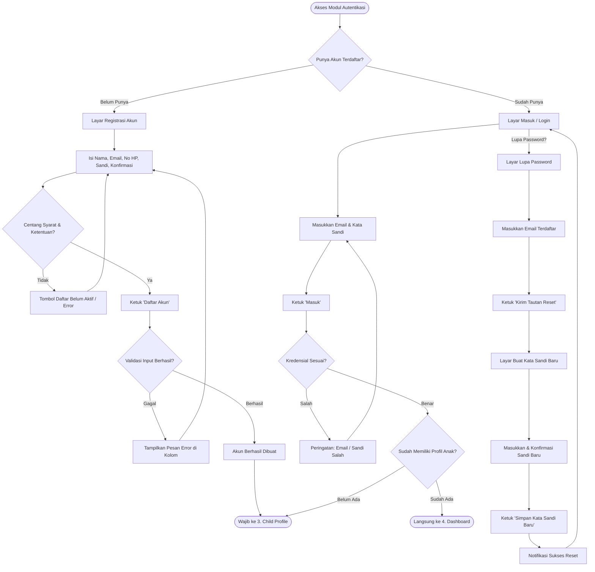

# 2. Authentication

## Description
Sistem Autentikasi berfungsi sebagai gerbang masuk bagi orang tua atau pengasuh ke dalam aplikasi Celoteh. Fitur ini dirancang untuk memudahkan pendaftaran akun baru, masuk ke akun terdaftar, serta pemulihan kata sandi dengan alur yang jelas, aman, dan intuitif.

## Goal
* Memastikan akun orang tua terdaftar dengan alur yang mudah dan bebas hambatan.
* Memberikan akses personal ke profil anak, tema minat belajar, dan arsip perkembangan suara.
* Menyediakan alur pemulihan kata sandi yang cepat dan mudah dipahami.

## Constraint
* Akses akun diperuntukkan bagi Orang Tua atau Pengasuh dewasa.
* Pengguna baru wajib mengisi nama, email, nomor telepon, dan kata sandi yang valid.
* Password minimal 8 karakter dan dilengkapi fitur show/hide untuk kenyamanan pengguna.
* Pendaftaran memerlukan persetujuan terhadap Syarat & Ketentuan aplikasi.

## Flow
Buka Aplikasi → Login / Register → Child Profile (Pengguna Baru) / Dashboard (Pengguna Lama)

## User Flow

### Rincian Langkah User Flow
1. **Jalur Pendaftaran Pengguna Baru (Registration Path):**
   * Pengguna membuka Halaman Registrasi $\rightarrow$ Mengisi data lengkap (Nama, Email, No HP, Password $\ge 8$ karakter, Konfirmasi Password) $\rightarrow$ Mencentang Syarat & Ketentuan.
   * Pengguna mengetuk *"Daftar Akun"*. Jika validasi sukses, akun terdaftar dan pengguna **secara otomatis dialihkan ke pembuatan profil anak (3. Child Profile)**.
2. **Jalur Masuk Pengguna Lama (Login Path):**
   * Pengguna membuka Halaman Login $\rightarrow$ Memasukkan email dan kata sandi $\rightarrow$ Mengetuk *"Masuk"*.
   * Sistem memvalidasi kredensial:
     * Jika akun sudah memiliki data anak $\rightarrow$ Langsung diarahkan ke **4. Dashboard**.
     * Jika akun belum memiliki data anak $\rightarrow$ Diarahkan ke **3. Child Profile**.
3. **Jalur Pemulihan Sandi (Forgot Password Path):**
   * Dari halaman Login, pengguna mengetuk *"Lupa Kata Sandi?"*.
   * Pengguna memasukkan email terdaftar $\rightarrow$ Mengetuk *"Kirim Tautan"* $\rightarrow$ Membuka tautan reset dan membuat kata sandi baru $\rightarrow$ Mengetuk *"Simpan"* $\rightarrow$ Muncul notifikasi sukses dan kembali ke layar Login.

## UI Flow
Halaman Login
Logo Celoteh.
Teks sapaan: "Selamat Datang Kembali, Ayah/Bunda!".
Input email.
Input password (dilengkapi fitur show/hide).
Link "Lupa Password".
Tombol "Masuk".
Link "Belum punya akun? Daftar Sekarang".

Halaman Register
Logo Celoteh dan sub-header: "Mulai Dampingi Si Kecil Bersama Celoteh".
Input Nama Orang Tua.
Input Email.
Input Nomor Telepon/WhatsApp.
Input Password (dilengkapi fitur show/hide).
Input Konfirmasi Password (dilengkapi fitur show/hide).
Checkbox persetujuan Syarat & Ketentuan.
Tombol "Daftar Akun".
Link "Sudah punya akun? Masuk".

Alur & Halaman Lupa Password
Link "Lupa Password" pada Halaman Login mengarahkan ke form reset.
Input email terdaftar.
Tombol "Kirim Tautan Reset".
Input Password Baru & Konfirmasi Password Baru (dilengkapi fitur show/hide).
Tombol "Simpan Password Baru".
Notifikasi sukses: "Kata sandi berhasil diperbarui!" dan tombol "Masuk Sekarang".

Validasi Input
Email: Wajib diisi dengan format email yang valid.
Password: Wajib diisi minimal 8 karakter.
Konfirmasi Password: Wajib cocok dengan password baru.
Nama & Telepon: Wajib diisi pada form registrasi.
Syarat & Ketentuan: Wajib dicentang sebelum tombol daftar aktif.

## Hubungan Antar Fitur
* Pengguna baru yang berhasil mendaftar otomatis diarahkan ke **3. Child Profile** untuk memilih tema minat anak.
* Pengguna lama yang sudah memiliki profil anak langsung diarahkan ke **4. Dashboard**.
