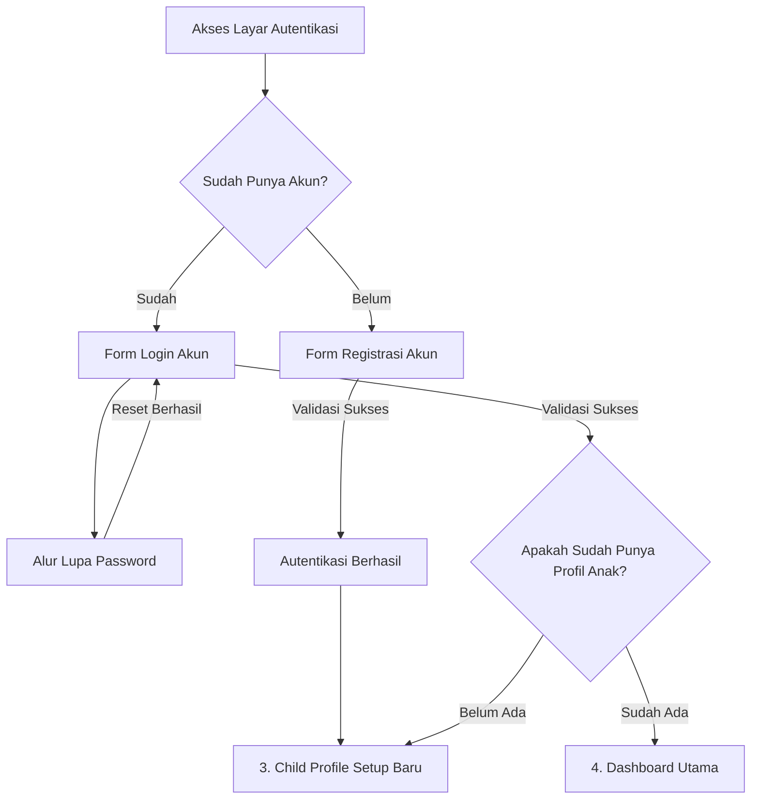

# 2. Authentication

---

## 1. Description
Sistem Autentikasi berfungsi sebagai gerbang keamanan utama untuk memverifikasi identitas pengguna (Orang Tua atau Pengasuh Legal) sebelum memberikan akses ke dalam ekosistem aplikasi Celoteh. Fitur ini dirancang untuk melindungi privasi data profil dan rekaman suara anak serta mengontrol hak akses fitur sesuai dengan sesi akun yang terverifikasi.

---

## 2. Goals & UX Metrics
* **Goal Utama:**
  * Memastikan kredensial orang tua terverifikasi secara aman melalui enkripsi standar industri.
  * Menjamin perlindungan data pribadi dan privasi rekaman suara anak (*Child Data Protection & Privacy Compliance*).
  * Menyediakan pengalaman pendaftaran (*sign-up*), masuk akun (*sign-in*), dan pemulihan kata sandi (*forgot password*) yang intuitif tanpa friksi.
* **UX Metrics:**
  * **Registration Success Rate:** $\ge 90\%$ tanpa mengalami kesalahan input yang berulang.
  * **Login Task Success Time:** $< 20$ detik untuk pengguna yang kembali (*returning user*).
  * **Form Error Recovery Rate:** Pengguna dapat memperbaiki kesalahan validasi form secara mandiri melalui *real-time inline error message*.

---

## 3. Constraints & Security Principles
* **Peran Akun (User Role):** Dikhususkan bagi Orang Tua / Pengasuh Dewasa. Anak tidak memiliki akun mandiri; anak berinteraksi melalui akun orang tua.
* **Kepatuhan Privasi Data Anak:** Formulir registrasi mewajibkan persetujuan eksplisit terhadap Syarat & Ketentuan serta Kebijakan Privasi terkait perekaman dan penyimpanan data suara anak di bawah umur.
* **Standar Keamanan Kata Sandi:** Minimal 8 karakter, mencakup kombinasi huruf dan angka. Disimpan dengan enkripsi aman.
* **Manajemen Sesi:** Token sesi aman disimpan di penyimpanan terenkripsi perangkat agar orang tua tidak perlu berulang kali login setiap membuka aplikasi, kecuali memilih opsi *Keluar (Logout)*.

---

## 4. User Flow & Conditional Routing

---

## 5. UI Flow & Spesifikasi Komponen

### A. Halaman Masuk (Login Screen)
* **Elemen Visual:** Logo Celoteh, ilustrasi ramah keluarga, serta teks sapaan *"Selamat Datang Kembali, Ayah/Bunda!"*.
* **Field Input:**
  * **Email:** Input teks dengan placeholder *"contoh: bunda@email.com"* + validasi format email.
  * **Kata Sandi:** Input teks tersamar (*masked*) + ikon tombol *Show/Hide Password*.
* **Aksi Tambahan:**
  * Tautan *"Lupa Kata Sandi?"* (mengarah ke formulir reset kata sandi).
* **CTA Utama:**
  * **Tombol "Masuk":** Tombol penuh berkontras tinggi (Primary Button).
* **Navigasi Bawah:**
  * Teks ajakan: *"Belum punya akun? "* + Tautan teks tebal *"Daftar Sekarang"* (mengarah ke Halaman Registrasi).

---

### B. Halaman Pendaftaran (Register Screen)
* **Elemen Visual:** Logo Celoteh, sub-header: *"Mulai Perjalanan Komunikasi Si Kecil Bersama Celoteh"*.
* **Field Input:**
  * **Nama Lengkap Orang Tua:** Input teks (nama pemegang akun).
  * **Alamat Email:** Input teks dengan validasi keunikan dan format email.
  * **Nomor Telepon/WhatsApp:** Input angka untuk opsi verifikasi akun.
  * **Kata Sandi:** Input teks tersamar + indikator kekuatan sandi + ikon *Show/Hide Password*.
  * **Konfirmasi Kata Sandi:** Input teks tersamar untuk memastikan kecocokan dengan sandi utama.
* **Persetujuan Kepatuhan & Privasi:**
  * Checkbox interaktif wajib dicentang: *"Saya menyetujui Syarat & Ketentuan serta Kebijakan Privasi terkait perlindungan data anak di Celoteh."*
* **CTA Utama:**
  * **Tombol "Daftar Akun":** Aktif setelah semua field valid dan checkbox dicentang.
* **Navigasi Bawah:**
  * Teks ajakan: *"Sudah memiliki akun? "* + Tautan teks tebal *"Masuk"* (mengarah ke Halaman Login).

---

### C. Alur Pemulihan Kata Sandi (Forgot Password Flow)
1. **Layar 1 – Permintaan Reset:**
   * Headline: *"Lupa Kata Sandi?"*
   * Deskripsi: *"Masukkan alamat email yang terdaftar. Kami akan mengirimkan tautan/kode verifikasi untuk mengatur ulang kata sandi Anda."*
   * Input Email + Tombol *"Kirim Tautan Reset"*.
2. **Layar 2 – Verifikasi Kode OTP (opsional / via Link Email):**
   * Input kode verifikasi 6 digit dengan timer hitung mundur (*Resend code in 60s*).
3. **Layar 3 – Buat Kata Sandi Baru:**
   * Field *Kata Sandi Baru* & *Konfirmasi Kata Sandi Baru* (lengkap dengan toggle *Show/Hide*).
   * Tombol *"Simpan Kata Sandi Baru"*.
4. **Layar 4 – Konfirmasi Sukses:**
   * Ilustrasi centang hijau / maskot tersenyum + pesan: *"Kata sandi berhasil diperbarui! Silakan masuk kembali."*
   * Tombol *"Kembali ke Halaman Masuk"*.

---

## 6. Aturan Validasi & Error Handling
* **Email Kosong / Format Salah:** Pesan error di bawah field: *"Format email tidak valid (contoh: nama@domain.com)"*.
* **Kata Sandi Lemah / Kurang dari 8 Karakter:** Pesan error: *"Kata sandi minimal 8 karakter dan mengandung kombinasi huruf serta angka"*.
* **Kata Sandi Konfirmasi Tidak Cocok:** Pesan error: *"Konfirmasi kata sandi tidak sesuai"*.
* **Kredensial Salah saat Login:** Tampilan pesan peringatan atas: *"Email atau kata sandi salah. Silakan periksa kembali."*
* **Checkbox Privasi Belum Dicentang:** Tombol pendaftaran non-aktif (disabled) atau memunculkan tooltip pengingat saat disentuh.

---

## 7. Hubungan dengan Modul Fitur Lain
* **Hubungan dengan `PRD.md`:** Mengimplementasikan fitur Authentication yang tercantum pada Bab Features & Information Architecture.
* **Hubungan dengan `3. Child Profile.md`:** 
  * Pengguna yang baru selesai mendaftar (*first-time register*) **wajib dialihkan langsung ke formulir pembuatan profil anak**.
* **Hubungan dengan `4. Dashboard.md`:** 
  * Pengguna lama (*returning user*) yang sudah memiliki profil anak langsung dialihkan ke layar utama Dashboard setelah login berhasil.
