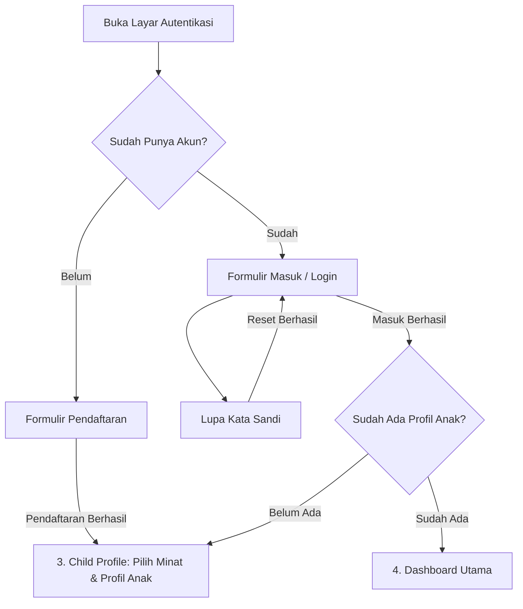

# 2. Authentication

---

## 1. Description
Sistem Autentikasi berfungsi sebagai pintu masuk bagi orang tua atau pengasuh ke dalam aplikasi Celoteh. Fitur ini dirancang untuk memudahkan proses pendaftaran akun baru, masuk ke akun yang sudah ada, serta pemulihan kata sandi dengan alur yang cepat, jelas, dan ramah pengguna.

---

## 2. Goals & UX Metrics
* **Goal Utama:**
  * Memberikan alur masuk (*sign-in*) dan pendaftaran (*sign-up*) yang ringkas dan bebas hambatan.
  * Memastikan orang tua dapat mengakses profil anak dan riwayat latihannya kapan saja.
  * Menyediakan penanganan kesalahan input form (*form error feedback*) yang jelas dan mudah dipahami pengguna.
* **UX Metrics:**
  * **Sign-up Success Rate:** $\ge 90\%$ pengguna baru berhasil mendaftar tanpa hambatan input.
  * **Login Task Time:** $< 15$ detik untuk pengguna yang sudah memiliki akun.

---

## 3. Constraints & Principles
* **Peran Pengguna:** Diperuntukkan bagi Orang Tua / Pengasuh. Anak tidak memerlukan akun terpisah, melainkan beraktivitas di bawah pendampingan orang tua.
* **Input yang Jelas & Terbantu:** Field kata sandi dilengkapi dengan fitur intip sandi (*show/hide password*) agar orang tua terhindar dari kesalahan pengetikan.
* **Alur Sederhana:** Tidak membebani pengguna dengan langkah formulir yang terlalu panjang pada saat pendaftaran.

---

## 4. User Flow & Routing

---

## 5. UI Flow & Spesifikasi Komponen

### A. Halaman Masuk (Login Screen)
* **Elemen Visual:** Logo Celoteh dan ilustrasi sapaan ramah *"Selamat Datang Kembali, Ayah/Bunda!"*.
* **Field Input:**
  * **Email:** Input teks dengan placeholder *"contoh: bunda@email.com"*.
  * **Kata Sandi:** Input teks tersamar dengan ikon tombol *Show/Hide Password*.
* **Tautan Tambahan:**
  * *"Lupa Kata Sandi?"* di bawah kolom kata sandi.
* **CTA Utama:**
  * **Tombol "Masuk":** Tombol utama berkontras tinggi.
* **Navigasi Bawah:**
  * Teks: *"Belum punya akun? "* + Tautan *"Daftar Sekarang"*.

---

### B. Halaman Pendaftaran (Register Screen)
* **Elemen Visual:** Logo Celoteh dan sub-header *"Mulai Dampingi Si Kecil Bersama Celoteh"*.
* **Field Input:**
  * **Nama Orang Tua:** Input teks (nama sapaan ayah/bunda).
  * **Email:** Input teks dengan validasi format email.
  * **Kata Sandi:** Input teks tersamar + ikon *Show/Hide Password*.
  * **Konfirmasi Kata Sandi:** Input teks untuk mencocokkan kata sandi.
* **Persetujuan Pengguna:**
  * Checkbox sederhana: *"Saya menyetujui Syarat & Ketentuan Celoteh."*
* **CTA Utama:**
  * **Tombol "Daftar Akun":** Tombol penuh yang aktif setelah data terisi valid.
* **Navigasi Bawah:**
  * Teks: *"Sudah punya akun? "* + Tautan *"Masuk"*.

---

### C. Alur Lupa Kata Sandi (Forgot Password)
1. **Layar Masukkan Email:**
   * Judul: *"Atur Ulang Kata Sandi"*
   * Deskripsi: *"Masukkan email yang terdaftar untuk menerima tautan atur ulang kata sandi."*
   * Field Email + Tombol *"Kirim Tautan"*.
2. **Layar Kata Sandi Baru:**
   * Input *Kata Sandi Baru* dan *Konfirmasi Kata Sandi Baru*.
   * Tombol *"Simpan Kata Sandi Baru"*.
3. **Layar Sukses:**
   * Notifikasi centang hijau: *"Kata sandi berhasil diubah! Silakan masuk kembali."*
   * Tombol *"Masuk Sekarang"*.

---

## 6. Feedback & Validasi Form
* **Format Email Tidak Sesuai:** Pesan di bawah input *"Mohon gunakan format email yang benar (contoh: nama@email.com)"*.
* **Kata Sandi Pendek:** Pesan di bawah input *"Kata sandi minimal 8 karakter"*.
* **Konfirmasi Sandi Berbeda:** Pesan di bawah input *"Kata sandi tidak sama"*.
* **Kredensial Tidak Cocok:** Pesan peringatan *"Email atau kata sandi tidak sesuai. Silakan periksa kembali."*

---

## 7. Hubungan dengan Modul Fitur Lain
* **Hubungan dengan `PRD.md`:** Menjadi gerbang identitas pengguna aplikasi.
* **Hubungan dengan `3. Child Profile.md`:** Pengguna baru setelah mendaftar akan **langsung diarahkan membuat profil anak dan memilih tema minat pertama**.
* **Hubungan dengan `4. Dashboard.md`:** Pengguna lama yang sudah memiliki profil anak langsung diarahkan ke Dashboard utama.
