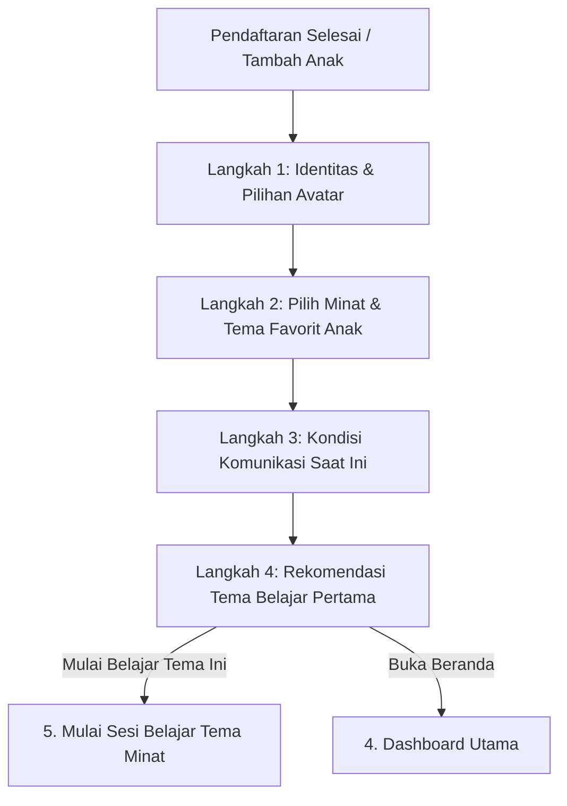

# 3. Child Profile

---

## 1. Description
Fitur **Child Profile** memungkinkan orang tua membuat dan mengelola data anak. Fitur ini dirancang khusus untuk memetakan **minat dan karakter anak** serta kondisi komunikasi awalnya. 

Pendekatan Celoteh mengutamakan apa yang disukai anak (*interest-based*). Data minat yang dipilih orang tua pada profil ini akan langsung digunakan untuk:
1. Menentukan **Tema Belajar Pertama** yang direkomendasikan pada **Dashboard**.
2. Memberikan pin label *"Favorit Si Kecil"* pada katalog **Learning Material**.
3. Menjadi dasar pemantauan kosakata anak pada **Progress Tracking**.

---

## 2. Goals & UX Metrics
* **Goal Utama:**
  * Mengetahui topik dan tema yang paling membuat anak antusias untuk mulai bersuara dan berbicara.
  * Memberikan pengalaman awal yang terpersonalisasi tanpa membuat orang tua merasa sedang dites atau dihakimi.
  * Mengatur profil anak yang dapat diganti dengan mudah jika orang tua memiliki lebih dari satu anak (*multi-child switcher*).
* **UX Metrics:**
  * **Profile Setup Completion Rate:** $\ge 90\%$ pengguna baru menyelesaikan form profil anak hingga selesai.
  * **Setup Duration:** Selesai dalam waktu cepat (1–2 menit) menggunakan format kartu visual interaktif.

---

## 3. Constraints & Principles
* **Berbasis Minat, Bukan Level:** Profil tidak mengelompokkan anak ke dalam tingkatan (*level*) kemampuan yang kaku, melainkan mengarahkan stimulasi ke topik yang disukai anak.
* **Format Ramah & Non-Diagnostik:** Pertanyaan disajikan dalam bahasa sehari-hari yang hangat, bukan kuisioner klinis yang menegangkan.
* **Dukungan Multi-Profil Anak:** Orang tua dapat menambahkan lebih dari satu anak dan dapat beralih profil dengan mudah kapan saja.

---

## 4. User Flow

---

## 5. UI Flow & Spesifikasi Komponen

### Langkah 1: Identitas & Pilihan Avatar Anak
* **Header:** Progress Step 1/3 – *"Kenalkan Si Kecil"*.
* **Pilihan Avatar:**
  * 6 pilihan ilustrasi avatar kartun anak yang ceria dan ramah.
* **Field Input:**
  * **Nama Panggilan Anak:** Input teks pendek (contoh: *"Kayla"*).
  * **Tanggal Lahir Anak:** Pemilih tanggal (*date picker*) yang otomatis menampilkan usia (contoh: *"3 Tahun 2 Bulan"*).
  * **Jenis Kelamin:** Tombol pilihan chip: Laki-laki / Perempuan.
* **Tombol Bawah:**
  * Tombol *"Lanjut: Pilih Minat Anak"*.

---

### Langkah 2: Pilih Minat & Tema Favorit Anak (Fokus Utama)
* **Header:** Progress Step 2/3 – *"Apa yang Paling Disukai Si Kecil?"*.
* **Deskripsi:** *"Anak lebih cepat dan semangat belajar bicara lewat hal-hal yang mereka sukai. Pilih 1–3 tema favoritnya:"*
* **Pilihan Kartu Bergambar (Multi-Select Cards dengan Icon Ceria):**
  * 🐶 **Hewan Peliharaan:** Kucing, anjing, kelinci, burung.
  * 🍎 **Buah & Makanan:** Buah manis, susu, camilan favorit.
  * 🚗 **Kendaraan & Mobil:** Mobil, bus, kereta, pesawat.
  * 🛋️ **Benda di Rumah:** Mainan, sofa, lampu, kasur.
  * 🦖 **Dinosaurus & Alam:** Dinosaurus, pohon, bunga, bintang.
  * 👨‍👩‍👧 **Keluarga:** Ayah, bunda, kakak, adik.
* **Tombol Bawah:**
  * Tombol *"Kembali"* dan tombol *"Lanjut: Kondisi Komunikasi"*.

---

### Langkah 3: Kondisi Komunikasi Saat Ini (Asesmen Ringkas)
* **Header:** Progress Step 3/3 – *"Kondisi Komunikasi Saat Ini"*.
* **Pertanyaan Pilihan Tunggal (Kartu Sentuh Cepat):**
  1. **Apakah si kecil sudah mulai bersuara atau berceloteh?**  
     *Pilihan:* Belum bersuara · Kadang bergumam · Sering berceloteh.
  2. **Perkiraan jumlah kata yang bisa diucapkan:**  
     *Pilihan:* Belum ada kata · 1–10 kata · 11–50 kata · Lebih dari 50 kata.
  3. **Respons saat namanya dipanggil:**  
     *Pilihan:* Jarang menoleh · Kadang menoleh · Selalu merespons.
  4. **Cara menyampaikan keinginan:**  
     *Pilihan:* Menarik tangan / menangis · Menunjuk benda · Bersuara / mengucapkan kata.
* **Tombol Bawah:**
  * Tombol *"Kembali"* dan tombol *"Selesaikan & Lihat Tema"*.

---

### Langkah 4: Layar Rekomendasi Tema Minat (Personalized Welcome)
* **Elemen Visual:** Ilustrasi perayaan gembira dengan avatar yang dipilih.
* **Sapaan:** *"Siap bermain dan belajar bicara bersama Kayla!"*
* **Kartu Rekomendasi Tema Pertama (Berdasarkan Minat Terpilih):**
  * Judul: *"Tema Favorit untuk Memulai: 🐶 Hewan Peliharaan"*
  * Keterangan: *"Mengenal kata dan suara kucing, kelinci, dan ayam yang disukai Kayla."*
* **Aksi Navigasi (Dual Action):**
  * **Tombol Utama (Primary CTA):** *"Mulai Belajar Tema Ini"* $\rightarrow$ langsung membuka kata pertama dalam tema tersebut di **5. Learning Material**.
  * **Tombol Sekunder:** *"Buka Beranda (Dashboard)"* $\rightarrow$ menuju **4. Dashboard**.

---

## 6. Fitur Pengalih Profil Anak (Child Switcher)
* Terdapat di bagian *Header Dashboard* dan *Header Progress Tracking*.
* Menampilkan avatar dan nama anak yang aktif saat ini.
* Jika ditekan, membuka *Bottom Sheet*:
  * Daftar profil anak yang sudah didaftarkan orang tua.
  * Tombol *"Tambah Profil Anak Baru"* (+) yang membuka kembali formulir ini.
  * Memilih anak lain otomatis mengubah konteks tema belajar dan riwayat progres.

---

## 7. Hubungan dengan Modul Fitur Lain
* **Hubungan dengan `PRD.md`:** Menjadi fondasi kurikulum berbasis minat anak.
* **Hubungan dengan `2. Authentication.md`:** Langkah wajib bagi orang tua yang baru selesai mendaftar.
* **Hubungan dengan `4. Dashboard.md`:** Menampilkan nama, avatar, dan tema minat aktif di kartu utama Dashboard.
* **Hubungan dengan `5. Learning Material.md`:** Memberi tanda *"Favorit Kayla"* pada katalog tema pembelajaran yang dipilih.
* **Hubungan dengan `6. Progress Tracking.md`:** Menjadi pembanding capaian kosakata yang dikuasai anak per tema minat.
