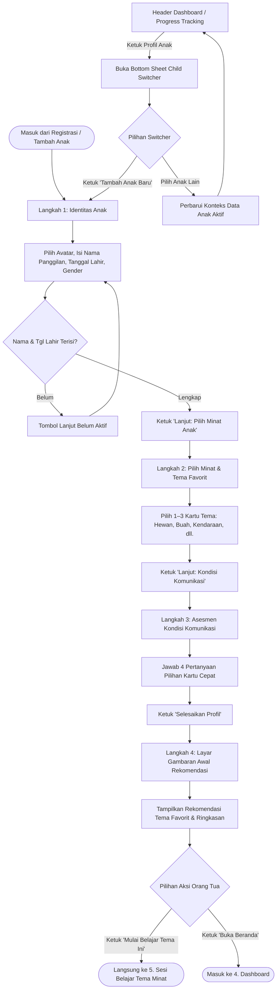

# 3. Child Profile

## Description
User dapat membuat dan mengelola profil anak yang berisi informasi dasar (nama, tanggal lahir, usia), kondisi komunikasi awal, serta **pemetaan minat dan tema favorit anak**. Informasi minat tersebut digunakan sebagai dasar utama untuk merekomendasikan tema pembelajaran di Learning Material, mempersonalisasi kartu Dashboard, dan memantau perkembangan kosakata anak di Progress Tracking.

## Goal
* Mengetahui minat dan topik favorit yang membuat anak antusias untuk mulai bersuara dan berbicara.
* Menyimpan informasi dasar dan kondisi komunikasi awal anak dalam satu tempat.
* Memberikan rekomendasi tema belajar yang relevan dan menyenangkan berdasarkan apa yang disukai anak.
* Memudahkan pemantauan perkembangan anak melalui fitur Progress Tracking.
* Mendukung pengelolaan lebih dari satu anak dalam satu akun orang tua.

## Constraint
* Fitur diakses oleh orang tua atau pengasuh yang telah memiliki akun.
* Pengguna wajib mengisi nama panggilan dan tanggal lahir anak.
* Pendekatan kurikulum berbasis minat anak, bukan berdasarkan tingkatan level kaku.
* Satu akun orang tua dapat mengelola lebih dari satu profil anak.
* Data kondisi komunikasi awal tidak dianggap sebagai diagnosis medis.

## Flow
Register / Login → Buat Profil Anak → Pilih Minat & Tema Favorit → Kondisi Komunikasi → Gambaran Awal → Dashboard / Mulai Belajar

## User Flow

### Rincian Langkah User Flow
1. **Titik Masuk (Entry Point):** Pengguna baru yang selesai mendaftar, atau pengguna lama yang memilih *"Tambah Anak Baru"* dari tombol switcher.
2. **Langkah 1: Pengisian Identitas (Identitas & Avatar):**
   * Pengguna memilih 1 dari 6 avatar kartun ceria $\rightarrow$ Memasukkan nama panggilan anak $\rightarrow$ Memilih tanggal lahir (sistem otomatis menghitung usia anak) $\rightarrow$ Memilih gender $\rightarrow$ Mengetuk *"Lanjut"*.
3. **Langkah 2: Pemilihan Minat (Interest Mapping - Inti Pendekatan):**
   * Pengguna memilih 1–3 tema favorit yang paling disukai anak (misal: Hewan Peliharaan, Kendaraan, atau Buah & Makanan) $\rightarrow$ Mengetuk *"Lanjut"*.
4. **Langkah 3: Asesmen Komunikasi Sederhana:**
   * Pengguna menjawab 4 pertanyaan ringkas tentang kondisi bicara anak saat ini menggunakan kartu pilihan sekali sentuh $\rightarrow$ Mengetuk *"Selesaikan Profil"*.
5. **Langkah 4: Rekomendasi Tema Belajar (Gambaran Awal):**
   * Sistem menyajikan sapaan personal dan kartu rekomendasi tema pertama yang disesuaikan dengan minat anak (misal: *"Tema: Hewan Peliharaan"*).
   * **Percabangan Aksi:**
     * Pengguna dapat langsung mengetuk *"Mulai Belajar Tema Ini"* untuk menuju **5. Learning Material**.
     * Pengguna dapat mengetuk *"Buka Beranda (Dashboard)"* untuk menuju **4. Dashboard**.
6. **Alur Pengalih Profil Anak (Child Switcher Flow):**
   * Orang tua mengetuk kartu nama/avatar anak di header Dashboard atau Progress Tracking $\rightarrow$ Muncul *bottom sheet* daftar anak $\rightarrow$ Memilih anak lain untuk berganti konteks atau menekan *"Tambah Anak Baru"* untuk mendaftarkan anak kedua.

## UI Flow
Langkah 1: Identitas Anak
Pilihan avatar kartun anak (6 karakter ilustrasi ceria).
Input Nama panggilan anak.
Input Tanggal lahir (usia terhitung otomatis).
Pilihan jenis kelamin: Laki-laki / Perempuan.
Tombol "Lanjut: Pilih Minat Anak".

Langkah 2: Pilih Minat & Tema Favorit (Fokus Utama)
Judul: "Apa yang Paling Disukai Si Kecil?".
Deskripsi: "Pilih 1–3 tema yang paling membuat anak antusias:"
Pilihan kartu tema bergambar interaktif:
- 🐶 Hewan Peliharaan (Kucing, Kelinci, Ayam, Ikan)
- 🍎 Buah & Makanan (Apel, Pisang, Susu, Roti)
- 🚗 Kendaraan (Mobil, Kereta, Pesawat, Sepeda)
- 🛋️ Benda di Rumah (Sofa, Meja, Lampu, Kasur)
- 🦖 Dinosaurus & Alam (Dino, Pohon, Bunga, Bintang)
- 👨‍👩‍👧 Keluarga (Ayah, Ibu, Kakak, Adik)
Tombol Previous.
Tombol "Lanjut: Kondisi Komunikasi".

Langkah 3: Kondisi Komunikasi Saat Ini
Judul: "Tahap Komunikasi Saat Ini".
Pertanyaan pilihan kartu sentuh cepat:
- Apakah anak sudah mengeluarkan suara/celoteh? (Belum / Kadang / Sering).
- Berapa kata yang sudah bisa diucapkan? (0 / 1–10 / 11–50 / >50).
- Apakah anak merespons saat dipanggil? (Jarang / Kadang / Selalu).
- Cara anak menyampaikan keinginan (Menarik tangan / Menunjuk / Suara / Kata).
Pertanyaan pendukung: Sudah pernah terapi wicara? (Pernah / Belum).
Tombol Previous.
Tombol "Selesaikan Profil".

Langkah 4: Gambaran Awal (Rekomendasi Tema Minat)
Sapaan personal: "Terima kasih, Bunda! Ini tema awal yang disiapkan untuk Kayla."
Kartu rekomendasi tema pertama berdasarkan minat anak (contoh: "Tema: 🐶 Hewan Peliharaan").
Ringkasan kondisi awal dalam bentuk kartu visual.
Catatan ramah: "Hasil ini membantu kami memilihkan tema belajar yang pas. Bukan merupakan diagnosis medis."
Tombol Utama: "Mulai Belajar Tema Ini".
Tombol Sekunder: "Buka Beranda (Dashboard)".

Fitur Pengalih Profil Anak (Child Switcher)
Header profil anak aktif di Dashboard dan Progress Tracking.
Bottom sheet daftar anak terdaftar (foto/avatar, nama, usia).
Tombol "Tambah Profil Anak Baru".

## Hubungan Antar Fitur
* Menjadi langkah wajib setelah registrasi akun orang tua.
* Tema yang dipilih menjadi acuan kartu "Rekomendasi Tema" di Dashboard dan label "Rekomendasi" pada Learning Material.
* Data profil anak menjadi acuan penyaringan data di Progress Tracking.
