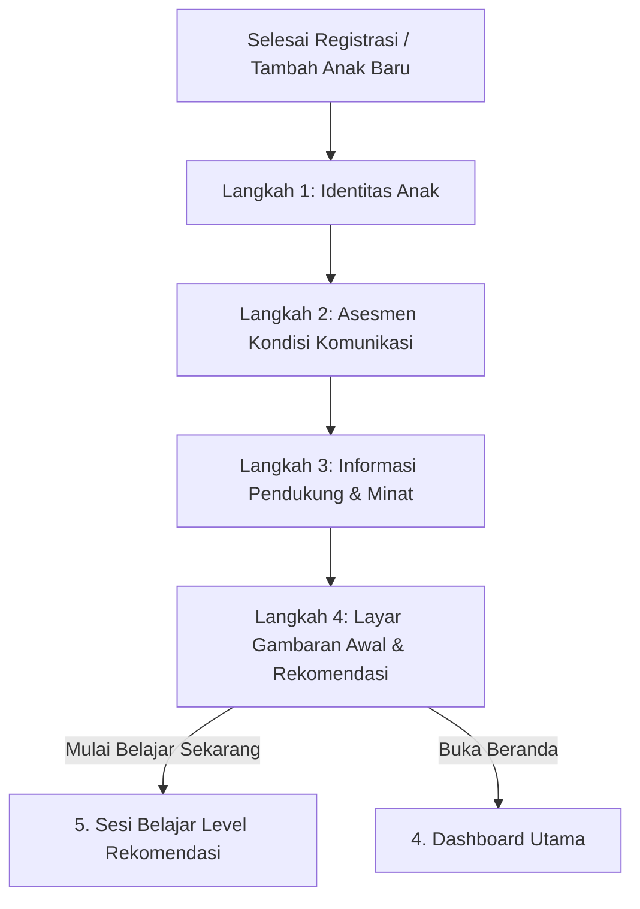

# 3. Child Profile

---

## 1. Description
Fitur **Child Profile** memungkinkan orang tua membuat dan mengelola data perkembangan anak. Fitur ini mengumpulkan informasi dasar identitas anak (nama, tanggal lahir, usia) serta data observasi awal mengenai kemampuan komunikasi dan bahasa anak melalui kuesioner terstruktur yang ramah orang tua. 

Data asesmen awal ini dijadikan dasar personalisasi untuk:
1. Menentukan rekomendasi level awal pembelajaran di **Learning Material**.
2. Memberikan label tema prioritas yang disukai anak.
3. Mengukur garis dasar (*baseline*) perkembangan anak pada **Progress Tracking**.

---

## 2. Goals & UX Metrics
* **Goal Utama:**
  * Membangun profil perkembangan anak yang akurat dan terpersonalisasi dalam satu tempat yang aman.
  * Memberikan rekomendasi jalur belajar yang relevan sesuai tahap kesiapan bicara dan preferensi anak tanpa membingungkan orang tua.
  * Menyediakan basis data pembanding (*baseline comparison*) untuk fitur pemantauan perkembangan dan evaluasi bersama terapis wicara.
* **UX Metrics:**
  * **Profile Onboarding Completion Rate:** $\ge 90\%$ pengguna baru berhasil melengkapi form profil anak hingga tahap *Gambaran Awal*.
  * **Form Completion Time:** Selesai dalam rata-rata waktu 2–3 menit (berkat format pertanyaan pilihan ganda/kartu visual, bukan esai panjang).

---

## 3. Constraints & Ethical Principles
* **Akses & Otoritas:** Hanya dapat diakses dan diubah oleh akun orang tua/pengasuh yang telah terautentikasi.
* **Multi-Child Support:** Satu akun orang tua dapat mendaftarkan dan beralih (*switch*) lebih dari satu profil anak (misal: anak pertama dan anak kedua).
* **Non-Medical Disclaimer (Etika AI/HealthTech):** Sistem secara tegas menyatakan bahwa hasil kuesioner observasi awal **bukan merupakan diagnosis klinis atau vonis medis**, melainkan hanya panduan penyesuaian materi stimulasi di rumah.
* **Wajib vs Opsional:**
  * *Wajib:* Nama panggilan dan tanggal lahir (untuk menghitung usia otomatis dan menyesuaikan rentang norma perkembangan 2–6 tahun).
  * *Opsional / Fleksibel:* Foto avatar asli (disediakan alternatif avatar ilustrasi anak yang lucu dan aman privasi), riwayat terapi, dan preferensi tema. Data dapat diperbarui kapan saja di menu pengaturan profil.

---

## 4. User Flow

---

## 5. UI Flow & Spesifikasi Komponen

### Langkah 1: Identitas Anak
* **Header:** Progress Step 1/3 – *"Kenalkan Si Kecil"*.
* **Pilihan Avatar / Foto:**
  * Komponen lingkaran pemilih avatar: Orang tua dapat memilih 1 dari 6 karakter ilustrasi lucu atau mengunggah foto anak secara privat.
* **Field Input:**
  * **Nama Panggilan Anak:** Input teks pendek (contoh: *"Kayla"*). Digunakan untuk sapaan ramah di seluruh aplikasi.
  * **Tanggal Lahir Anak:** Date picker interaktif (menghasilkan kalkulasi usia otomatis, misal: *"3 Tahun 2 Bulan"*).
  * **Jenis Kelamin (Opsional):** Pilihan tombol chip: Laki-laki / Perempuan / Lewati.
* **CTA Bawah:**
  * Tombol *"Lanjut ke Kondisi Anak"* (Aktif jika nama dan tanggal lahir telah diisi).

---

### Langkah 2: Kondisi Komunikasi Saat Ini (Asesmen Cepat)
* **Header:** Progress Step 2/3 – *"Tahap Komunikasi Saat Ini"*.
* **Sub-header:** *"Pilih kondisi yang paling menggambarkan keseharian si kecil saat ini."* (Format kartu pilihan interaktif sekali sentuh / *single select card*):
  1. **Apakah anak sudah mulai mengeluarkan suara atau celoteh?**  
     *Pilihan:* Belum bersuara · Kadang-kadang bergumam · Sering berceloteh (*babbling*).
  2. **Berapa banyak kata bermakna yang sudah bisa diucapkan?**  
     *Pilihan:* Belum ada kata (0) · 1 – 10 kata · 11 – 50 kata · Lebih dari 50 kata.
  3. **Apakah anak merespons ketika namanya dipanggil?**  
     *Pilihan:* Jarang merespons · Kadang menoleh · Selalu merespons.
  4. **Apakah anak memahami instruksi satu langkah sederhana?** *(contoh: "ambil bola", "duduk di sini")*  
     *Pilihan:* Belum memahami · Memahami dengan bantuan gestur · Paham mandiri.
  5. **Bagaimana cara utama anak menyampaikan keinginannya?**  
     *Pilihan:* Menarik tangan / menangis · Menunjuk benda · Menggunakan suara gumaman · Mengucapkan kata / frasa.
* **CTA Bawah:**
  * Tombol navigasi *"Kembali"* dan tombol *"Lanjut"*.

---

### Langkah 3: Minat & Informasi Pendukung (Opsional)
* **Header:** Progress Step 3/3 – *"Minat & Riwayat Pendampingan"*.
* **Field Pertanyaan Pendukung:**
  1. **Apakah si kecil sedang / pernah menjalani terapi wicara dengan profesional?**  
     *Pilihan Toggle / Chip:* Sedang Terapi · Pernah Terapi · Belum Pernah.
     *(Jika dipilih sedang terapi, muncul input teks opsional: "Nama klinik / terapis" untuk keperluan ekspor laporan).*
  2. **Tema yang paling disukai si kecil:** *(Multi-select chip hingga 2 tema)*  
     *Pilihan:* 🐶 Hewan Peliharaan · 🍎 Buah & Makanan · 🛋️ Benda di Rumah · 🚗 Kendaraan · 🦖 Dinosaurus.
  3. **Fokus utama yang ingin dilatih:**  
     *Pilihan:* Menirukan suara alam/hewan · Menambah perbendaharaan kata dasar · Merangkai 2 kata.
* **CTA Bawah:**
  * Tombol navigasi *"Kembali"* dan tombol utama *"Selesaikan Profil"*.

---

### Langkah 4: Layar Gambaran Awal & Rekomendasi (Baseline Summary)
* **Elemen Visual:** Ilustrasi perayaan ramah, avatar anak yang terpilih, dan lencana selamat datang.
* **Sapaan Personal:** *"Terima kasih, Ayah/Bunda! Ini gambaran awal kesiapan komunikasi untuk Kayla."*
* **Kartu Rekomendasi Jalur Belajar:**
  * Badge Rekomendasi: *"Rekomendasi Jalur Mulai"*
  * Judul Modul: *"Level 1: Eksplorasi Suara & Kata Pertama"*
  * Tema Rekomendasi Pilihan Anak: *"Tema: Hewan Peliharaan & Ruang Tamu"*
* **Ringkasan Kartu Visual (Baseline Summary):**
  * Estimasi Kosakata Awal: 1–10 kata.
  * Respon Instruksi: Memahami dengan gestur.
  * Fokus Pembelajaran: Kosakata vokal & onomatope interaktif.
* **Kartu Catatan Etis (Medical Disclaimer Card):**
  * *"Catatan: Rangkuman ini bukan diagnosis medis. Celoteh berfungsi sebagai sarana stimulasi harian di rumah untuk mendampingi tumbuh kembang anak."*
* **Aksi Navigasi (Dual CTA):**
  * **Primary CTA:** Tombol *"Mulai Belajar Sekarang"* $\rightarrow$ langsung membuka sesi interaktif kata pertama yang direkomendasikan di **5. Learning Material**.
  * **Secondary CTA:** Tombol outline *"Buka Halaman Utama (Dashboard)"* $\rightarrow$ langsung mengarahkan ke **4. Dashboard**.

---

## 6. Manajemen Multi-Profil Anak (Child Profile Switcher)
Orang tua dapat mengelola profil lebih dari satu anak melalui fitur **Pengalih Profil**:
* Dapat diakses dari *Header Dashboard* dan *Header Progress Tracking*.
* Dropdown / Bottom sheet menampilkan daftar anak terdaftar (Foto, Nama, Usia).
* Terdapat tombol *"Tambah Profil Anak Baru"* yang mengarahkan kembali ke formulir pembuatan profil ini.
* Mengganti profil anak akan secara otomatis mengubah konteks seluruh data pada **Dashboard**, **Learning Material**, dan **Progress Tracking**.

---

## 7. Hubungan dengan Modul Fitur Lain
* **Hubungan dengan `PRD.md`:** Mengimplementasikan fitur Child Profile sebagai fondasi personalisasi kurikulum anak.
* **Hubungan dengan `2. Authentication.md`:** Menjadi langkah wajib bagi pengguna baru yang baru saja menyelesaikan registrasi.
* **Hubungan dengan `4. Dashboard.md`:** 
  * Menyuplai data nama anak, avatar, usia, serta level awal ke *Header & Child Card Dashboard*.
* **Hubungan dengan `5. Learning Material.md`:** 
  * Menempatkan pin label *"Rekomendasi"* pada tema belajar yang sesuai dengan minat dan level anak.
* **Hubungan dengan `6. Progress Tracking.md`:** 
  * Menyimpan status kondisi awal sebagai *baseline* pembanding pertumbuhan kosakata dan kemampuan komunikasi dari waktu ke waktu.
