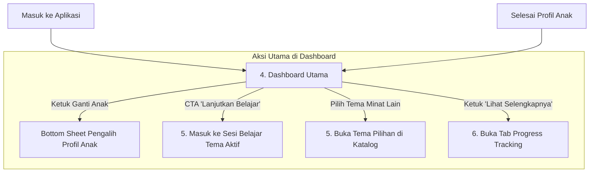

# 4. Dashboard Page

---

## 1. Description
Halaman **Dashboard** berfungsi sebagai beranda utama bagi orang tua dalam mendampingi aktivitas stimulasi bicara anak di Celoteh. Halaman ini menyajikan gambaran cepat mengenai tema minat yang sedang aktif dipelajari, konsistensi latihan harian (*streak*), ringkasan kosakata yang telah dicoba, serta akses cepat untuk langsung melanjutkan latihan kata berikutnya.

---

## 2. Goals & UX Metrics
* **Goal Utama:**
  * Memberikan visibilitas langsung terhadap tema minat dan kata yang sedang dipelajari anak (*at-a-glance awareness*).
  * Menjaga rutinitas latihan harian orang tua bersama anak melalui visualisasi konsistensi (*streak engagement*).
  * Mempermudah navigasi langsung ke materi latihan kata (*shortcut to learning*) dan riwayat perkembangan anak.
* **UX Metrics:**
  * **Quick-Start Rate:** $\ge 70\%$ pengguna membuka sesi latihan langsung melalui tombol *"Lanjutkan Belajar"* di Dashboard.
  * **Information Clarity:** Orang tua memahami tema aktif dan jumlah kata yang telah dilatih dalam $< 5$ detik.

---

## 3. Constraints & Principles
* **Berbasis Minat Anak, Bukan Tingkatan Level:** Tidak ada pengelompokan level kaku; kartu utama menampilkan tema minat yang sedang aktif dipelajari atau tema favorit anak.
* **Tampilan Bersih & Menyemangati:** Informasi disajikan secara visual dengan warna cerah dan ramah keluarga tanpa angka-angka teknis yang rumit.
* **Konteks Satu Anak Aktif:** Dashboard menampilkan data anak yang sedang dipilih, dengan kemudahan beralih anak melalui *Child Switcher* di header.

---

## 4. User Flow

---

## 5. UI Flow & Spesifikasi Komponen

### A. Navigasi Bawah (Bottom Navigation Bar)
* Terletak di bagian bawah layar dengan 4 tab navigasi utama:
  1. **Beranda (Dashboard):** [Status: Aktif] Ikon rumah.
  2. **Belajar (Learning Materials):** Ikon buku / materi belajar tema.
  3. **Progres (Progress Tracking):** Ikon grafik perkembangan & audio rekaman.
  4. **Profil (Pengaturan Akun):** Ikon pengaturan akun dan profil anak.

---

### B. Header & Pengalih Profil Anak (Child Switcher)
* **Sapaan Personal:** *"Selamat Pagi, Bunda!"*
* **Profil Anak Aktif:**
  * Menampilkan nama anak dan usia (contoh: *"Mendampingi Kayla (3 th)"*).
  * Avatar kartun anak dengan ikon panah kecil (*dropdown*).
  * **Interaksi:** Jika disentuh, membuka *Bottom Sheet* untuk beralih ke profil anak lain atau menambah profil baru (+).
* **Ikon Lonceng Notifikasi:** Pengingat ramah untuk sesi latihan hari ini.

---

### C. Streak Card: Konsistensi Latihan Harian
* **Tampilan Visual:** Kartu berlatar warna cerah beraksen hangat dengan ikon api/maskot gembira.
* **Pencapaian Streak:** *"🔥 5 Hari Berturut-turut"*
* **Indikator Mingguan:** Baris 7 hari (Sen, Sel, Rab, Kam, Jum, Sab, Min) dengan tanda centang pada hari latihan yang sudah selesai.
* **Pesan Semangat:** *"Hebat! Latihan rutin setiap hari membantu Kayla semakin berani bersuara."*

---

### D. Kartu Tema Minat Aktif (Primary Action Card)
* **Status Tema yang Sedang Dipelajari:**
  * Judul Tema: *"🐶 Tema: Hewan Peliharaan (Favorit Kayla)"*
  * Rincian Progres Kata: *"3 dari 5 kata telah dicoba"*
  * Progress Bar visual persentase (60%).
* **Kata Berikutnya yang Siap Dipelajari:**
  * Cuplikan kata: *"Kata berikutnya: Kelinci 🐰"*
* **CTA Utama (Primary Button):**
  * **Tombol "Lanjutkan Belajar":** Tombol kontras tinggi yang langsung membuka sesi belajar kata *"Kelinci"* di **5. Learning Material**.

---

### E. Eksplorasi Tema Berdasarkan Minat Anak
* **Header Bagian:** *"Tema Favorit Kayla Lainnya"* + Tautan *"Lihat Semua Tema"* (menuju katalog belajar).
* **Deretan Kartu Tema Bergambar (Horizontal Scroll):**
  * 🍎 **Buah & Makanan:** 4 kata · Belum dimulai.
  * 🚗 **Kendaraan:** 5 kata · 2 kata selesai.
  * 🦖 **Dinosaurus & Alam:** 4 kata · Belum dimulai.
* Mengetuk kartu tema langsung membuka detail kata dalam tema tersebut.

---

### F. Ringkasan Kosakata & Latihan Suara (Snapshot)
* **Header Bagian:** *"Perkembangan Bicara Kayla"* + Tautan teks *"Lihat Selengkapnya"* (menuju **6. Progress Tracking**).
* **2 Kartu Metrik Ringkas:**
  1. **Kata yang Dicoba:** *"8 Kata"* (Total kata dari berbagai tema yang sudah pernah dilatih).
  2. **Rekaman Suara:** *"12 Rekaman"* (Arsip rekaman suara anak yang tersimpan rapi).

---

### G. Aktivitas Terakhir (Recent Activity)
* **Header Bagian:** *"Aktivitas Latihan Terakhir"*
* **Kartu Riwayat Terkini:**
  * Gambar objek kata (contoh: Gambar Kucing).
  * Nama kata & tema: *"Kucing · Tema Hewan Peliharaan"*.
  * Waktu: *"Hari ini, 09.30 WIB"*.
  * Apresiasi: ⭐⭐⭐ (3 Bintang) + Ikon pemutar audio mini untuk mendengarkan kembali rekaman kata tersebut.

---

## 6. Hubungan dengan Modul Fitur Lain
* **Hubungan dengan `PRD.md`:** Menjadi beranda utama pemantauan aktivitas belajar berbasis minat dan streak latihan.
* **Hubungan dengan `3. Child Profile.md`:** Menampilkan nama, avatar, dan memprioritaskan tema yang dipilih pada profil anak.
* **Hubungan dengan `5. Learning Material.md`:** Tombol *"Lanjutkan Belajar"* dan kartu tema menjadi jalan pintas utama menuju sesi latihan kata.
* **Hubungan dengan `6. Progress Tracking.md`:** Menampilkan cuplikan ringkasan kata dan menghubungkan orang tua langsung ke riwayat rekaman suara lengkap.
