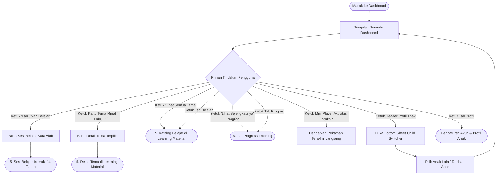

# 4. Dashboard Page

## Description
Halaman Dashboard adalah pusat navigasi dan ringkasan aktivitas belajar anak bagi orang tua. Halaman ini menyajikan informasi penting dalam sekali lihat mengenai profil anak yang sedang aktif, tema minat yang sedang dipelajari, konsistensi latihan harian (*streak*), ringkasan kosakata anak, serta akses cepat ke tombol "Lanjutkan Belajar".

## Goal
* Memberikan gambaran ringkas mengenai tema minat dan perkembangan kosakata yang sedang dipelajari anak.
* Mendorong orang tua menjaga konsistensi latihan harian melalui visualisasi streak.
* Mempermudah navigasi langsung ke sesi latihan kata berikutnya dan ke halaman pemantauan perkembangan.
* Mendukung pergantian profil anak dengan cepat (*multi-child switcher*).

## Constraint
* Menampilkan data spesifik dari profil satu anak yang sedang aktif.
* Berbasis tema minat yang disukai anak, bukan tingkatan level kaku.
* Tampilan visual bersih, ramah orang tua, dan bebas dari angka-angka rumit.
* Memiliki Bottom Navigation Bar konsisten di bagian bawah layar.

## Flow
Login / Selesai Profil → Dashboard → Lanjutkan Belajar / Pilih Tema / Lihat Progres

## User Flow

### Rincian Langkah User Flow
1. **Titik Masuk (Entry Point):** Pengguna berhasil login atau baru saja menyelesaikan pembuatan profil anak.
2. **Jalur Utama Latihan Harian (Primary Happy Path - "Lanjutkan Belajar"):**
   * Pengguna melihat kartu *Tema Minat Aktif* (misal: Tema Hewan Peliharaan, 3/5 kata selesai).
   * Pengguna melihat kata berikutnya yang siap dipelajari (*"Kata berikutnya: Kelinci"*).
   * Pengguna mengetuk tombol CTA utama *"Lanjutkan Belajar"*.
   * Sistem langsung meluncurkan **5. Sesi Belajar Interaktif (Tahap 1: Kenali)** untuk kata Kelinci.
3. **Jalur Eksplorasi Minat Lain (Exploration Path):**
   * Pengguna melihat deretan kartu horizontal tema favorit anak (misal: Kendaraan, Buah, Dinosaurus).
   * Pengguna mengetuk salah satu kartu tema $\rightarrow$ Sistem membuka halaman detail tema tersebut pada **5. Learning Material**.
4. **Jalur Pemantauan Progres Cepat (Progress Check Path):**
   * Pengguna melihat kartu *Streak* untuk memastikan latihan harian tetap aktif.
   * Pengguna melihat *Ringkasan Kosakata (Snapshot)* dan mengetuk *"Lihat Selengkapnya"* untuk membuka **6. Progress Tracking**.
   * Pengguna dapat mengetuk ikon mini audio player pada kartu *Aktivitas Terakhir* untuk langsung memutar rekaman suara latihan yang baru saja diselesaikan.
5. **Jalur Navigasi Bottom Bar (Global Navigation):**
   * Pengguna dapat berpindah kapan saja ke modul *Belajar*, *Progres*, atau *Profil* melalui tab bar di bagian bawah layar.

## UI Flow
Dashboard Page
Header & Child Profile Switcher: Sapaan personal (“Selamat Pagi, Bunda!”), nama anak aktif (“Mendampingi Kayla, 3 th”), avatar anak, dan dropdown bottom sheet ganti profil anak.
Ikon Notifikasi lonceng pengingat latihan harian.

Streak Card (Konsistensi Harian)
Indikator streak: “🔥 5 Hari Berturut-turut”.
Visualisasi mingguan: 7 lingkaran hari (Sen, Sel, Rab, Kam, Jum, Sab, Min) dengan tanda centang latihan selesai.
Pesan motivasi: “Hebat! Rutinitas latihan setiap hari membantu stimulasi bicara Kayla.”

Tema Minat Aktif (Aksi Utama)
Nama tema aktif: “🐶 Tema: Hewan Peliharaan (Favorit Kayla)”.
Progres kata dalam tema: “3 dari 5 kata telah dicoba”.
Progress bar visual persentase penyelesaian tema.
Preview kata berikutnya: “Kata berikutnya: Kelinci 🐰”.
Tombol CTA “Lanjutkan Belajar” (langsung membuka sesi belajar kata Kelinci).

Eksplorasi Tema Berdasarkan Minat Anak
Header: “Tema Favorit Kayla Lainnya” dan tautan “Lihat Semua Tema”.
Deretan kartu tema horizontal bergambar:
- 🍎 Buah & Makanan (4 kata, belum dimulai).
- 🚗 Kendaraan (5 kata, 2 kata selesai).
- 🦖 Dinosaurus & Alam (4 kata, belum dimulai).
Mengetuk kartu tema langsung membuka daftar kata dalam tema tersebut.

Ringkasan Kosakata & Suara (Snapshot)
Header: “Perkembangan Bicara Kayla” dan tautan “Lihat Selengkapnya”.
Kartu Kata yang Dicoba: “8 Kata”.
Kartu Rekaman Suara: “12 Rekaman Tersimpan”.

Aktivitas Belajar Terakhir
Header: “Aktivitas Latihan Terakhir”.
Kartu riwayat terkini:
- Gambar objek kata (contoh: Gambar Kucing).
- Nama materi dan tema: “Kucing · Tema Hewan Peliharaan”.
- Waktu aktivitas: “Hari ini, 09.30 WIB”.
- Status apresiasi: ⭐⭐⭐ (3 Bintang).
- Ikon pemutar audio mini untuk mendengarkan kembali rekaman saat itu.

Bottom Navigation Bar
Tab Beranda (Dashboard) [Aktif].
Tab Belajar (Learning Materials).
Tab Progres (Progress Tracking).
Tab Profil (Pengaturan Akun & Data Anak).

## Hubungan Antar Fitur
* Menampilkan profil dan tema favorit yang dipilih di **3. Child Profile**.
* Tombol "Lanjutkan Belajar" dan kartu tema mengarahkan langsung ke **5. Learning Material**.
* Tautan "Lihat Selengkapnya" dan aktivitas terakhir mengarahkan ke **6. Progress Tracking**.
* Menerima pembaruan progres tema dan streak secara langsung saat sesi belajar diselesaikan.
