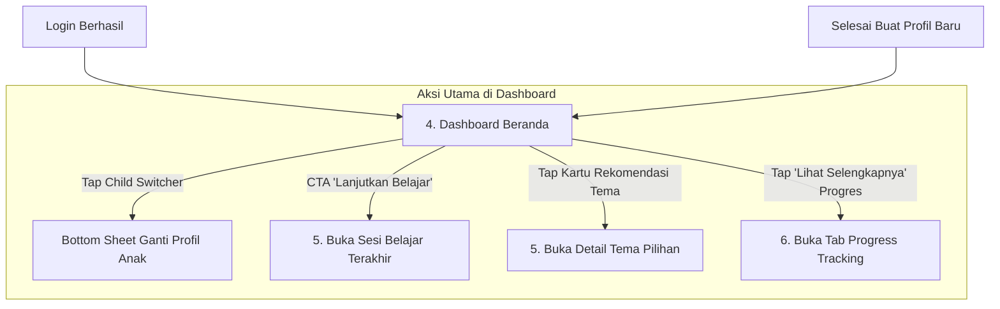

# 4. Dashboard Page

---

## 1. Description
Halaman **Dashboard** berfungsi sebagai beranda utama (*central hub*) bagi orang tua setiap kali membuka aplikasi Celoteh. Halaman ini dirancang untuk memberikan informasi komprehensif dalam sekali lihat (*at-a-glance awareness*) mengenai profil anak yang sedang aktif, tingkat konsistensi latihan harian (*streak*), status progres level belajar saat ini, dan ringkasan perkembangan komunikasi terbaru tanpa harus berpindah-pindah menu.

Dashboard juga berfungsi sebagai akselerator tindakan (*action trigger*) melalui tombol akses cepat *"Lanjutkan Belajar"* menuju sesi latihan harian si kecil.

---

## 2. Goals & UX Metrics
* **Goal Utama:**
  * Memberikan gambaran ringkas dan jelas mengenai pencapaian belajar serta perkembangan komunikasi anak (*Progress Awareness*).
  * Menjaga motivasi orang tua melalui pengingat konsistensi latihan harian (*Daily Habit & Streak Engagement*).
  * Mempermudah navigasi langsung (*Quick Shortcut*) ke sesi belajar aktif pada **Learning Material** dan laporan mendalam di **Progress Tracking**.
* **UX Metrics:**
  * **Daily Active User (DAU) to Learning Session Rate:** $\ge 70\%$ orang tua yang membuka dashboard menekan tombol *"Lanjutkan Belajar"*.
  * **Navigation Efficiency:** Orang tua dapat mengetahui level anak dan sisa materi dalam waktu $< 5$ detik setelah aplikasi terbuka.

---

## 3. Constraints & Principles
* **Single Active Child Context:** Dashboard selalu menampilkan data spesifik dari satu profil anak yang sedang dipilih. Jika orang tua memiliki lebih dari satu anak, orang tua dapat beralih profil dengan mudah melalui *Child Switcher* di bagian header.
* **Non-Overwhelming Data Display:** Data perkembangan disajikan dalam bentuk kartu visual yang bersih, tidak padat angka rumit, dan berfokus pada afirmasi positif (*encouraging & informative*).
* **Global Navigation Consistency:** Dashboard adalah tab pertama (*Beranda*) pada **Bottom Navigation Bar** yang selalu ada di layar utama aplikasi.

---

## 4. User Flow

---

## 5. UI Flow & Spesifikasi Komponen

### A. Global Navigation Bar (Bottom Navigation)
* Terletak di bagian bawah layar dengan 4 tab navigasi utama:
  1. **Beranda (Dashboard):** [Status: Aktif] Ikon rumah.
  2. **Belajar (Learning Materials):** Ikon buku / materi belajar interaktif.
  3. **Progres (Progress Tracking):** Ikon grafik perkembangan & audio rekaman.
  4. **Profil (Pengaturan Akun):** Ikon pengguna (pengaturan akun, notifikasi, dan data anak).

---

### B. Header & Child Profile Switcher (Bagian Atas)
* **Sapaan Personal & Profil Anak:**
  * Menampilkan teks ramah: *"Selamat Pagi, Bunda!"*
  * Nama panggilan anak aktif (misal: *"Mendampingi Kayla (3 th)"*).
  * Avatar ilustrasi anak dengan indikator panah kecil (*dropdown chevron*).
* **Fitur Switcher Anak (Pengalih Profil):**
  * Mengetuk area avatar/nama anak akan membuka *Bottom Sheet*:
    * Daftar kartu anak terdaftar (Foto/Avatar, Nama, Usia).
    * Tombol *"Tambah Anak Baru"* (+).
* **Ikon Notifikasi (Lonceng):** Pengingat jadwal stimulasi harian dan tips singkat mendampingi anak.

---

### C. Streak Card: Konsistensi Latihan Harian (Gamifikasi Orang Tua)
* **Tampilan Visual:** Kartu dengan aksen warna hangat (oranye/kuning ceria) berikon api / bintang tersenyum.
* **Indikator Streak:** *"🔥 5 Hari Berturut-turut"*
* **Visualisasi Mingguan:** Baris 7 lingkaran hari (Sen, Sel, Rab, Kam, Jum, Sab, Min) dengan centang pada hari yang telah diselesaikan sesi latihannya.
* **Pesan Afirmasi:** *"Hebat! Rutinitas latihan yang konsisten sangat membantu stimulasi bicara Kayla."*

---

### D. Learning Level Overview (Kartu Progres Utama)
* **Status Level Aktif:**
  * Label: *"Level 1: Eksplorasi Suara & Kata Pertama"*
  * Tag status: *"Sedang Berjalan"*
* **Level Progress Bar:**
  * Indikator persentase penyelesaian level (contoh: *65% Selesai*).
  * Keterangan jumlah materi: *"8 dari 12 kata telah dipelajari"*.
* **CTA Utama (Primary Action):**
  * **Tombol "Lanjutkan Belajar":** Tombol kontras tinggi dengan ikon panah / *play*, langsung membuka kata berikutnya yang belum dipelajari (*misal: "Lanjut Belajar: Kucing"*) di **5. Learning Material**.

---

### E. Rekomendasi Tema Latihan Hari Ini (Berdasarkan Profil Anak)
* **Header Bagian:** *"Rekomendasi Tema Hari Ini"*
* **Kartu Tema Unggulan:**
  * Menampilkan tema yang sesuai dengan preferensi minat anak dari *Child Profile* (contoh: *"Tema: Hewan Peliharaan"*).
  * Ilustrasi visual menarik, jumlah kata dalam tema (4 kata), dan progres saat ini (2/4 kata).
  * Mengetuk kartu langsung membawa pengguna ke **Detail Tema pada Learning Material**.

---

### F. Child Development Summary (Snapshot Perkembangan)
* **Header Bagian:** *"Ringkasan Kemampuan Komunikasi"* + Tautan teks: *"Lihat Selengkapnya"* (menuju **6. Progress Tracking**).
* **Grid 2 Kartu Metrik:**
  1. **Pemahaman Bahasa (Language Comprehension):**
     * Angka: *"14 Aktivitas Selesai"*
     * Keterangan: *"Mengenal objek dan respons instruksi sederhana."*
  2. **Ekspresi Verbal (Verbal Expression):**
     * Angka: *"8 Kata Dicoba"*
     * Keterangan: *"Rekaman suara peniruan kata tersimpan."*

---

### G. Recent Learning Activity (Riwayat Belajar Terakhir)
* **Header Bagian:** *"Aktivitas Terakhir"*
* **Daftar Kartu Riwayat (1–2 aktivitas terakhir):**
  * Ikon materi (misal gambar Apel).
  * **Nama Materi & Tema:** *"Apel · Tema Buah"*
  * **Waktu Aktivitas:** *"Hari ini, 09.30 WIB"*
  * **Status:** Badge hijau *"Selesai (3 Bintang ⭐)"* + Ikon pemutar audio mini untuk mendengarkan kembali rekaman saat itu.

---

## 6. Hubungan dengan Modul Fitur Lain
* **Hubungan dengan `PRD.md`:** Bertindak sebagai *central dashboard* yang mengintegrasikan seluruh elemen utama produk (streak, kurikulum, aktivitas, dan ringkasan progres).
* **Hubungan dengan `3. Child Profile.md`:** 
  * Menampilkan nama dan avatar anak pada header; menyediakan akses *Child Switcher*.
  * Menampilkan tema rekomendasi berdasarkan minat yang dipilih di profil anak.
* **Hubungan dengan `5. Learning Material.md`:** 
  * Tombol *"Lanjutkan Belajar"* dan *Kartu Tema Unggulan* menjadi gerbang utama menuju alur sesi belajar interaktif.
  * Menerima *real-time updates* saat materi baru diselesaikan (progres level naik dan streak bertambah).
* **Hubungan dengan `6. Progress Tracking.md`:** 
  * Menampilkan cuplikan ringkas (*snapshot*) metrik perkembangan.
  * Tautan *"Lihat Selengkapnya"* dan ikon rekaman pada aktivitas terakhir langsung mengarahkan ke tab *Progress Tracking*.
