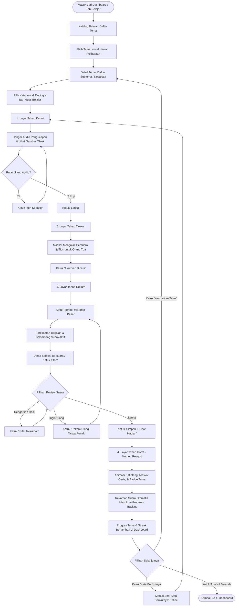

# 5. Learning Material

## Description
Fitur pembelajaran interaktif yang membantu anak mengembangkan kemampuan bahasa dan ekspresi verbal melalui materi visual dan audio yang disusun berdasarkan tema minat anak. Setiap materi disajikan dalam satu sesi belajar yang menyatu: anak mengenal objek dan kosakata melalui gambar dan audio; menirukan dan menjawab ajakan sederhana dengan merekam suaranya; lalu memperoleh apresiasi berupa bintang, lencana, dan progres tema. Rekaman suara tersimpan otomatis sebagai riwayat latihan yang dapat dipantau orang tua.

## Goal
* Menyediakan stimulasi bahasa terstruktur berdasarkan tema minat yang disukai anak.
* Menggabungkan belajar, berlatih bicara, dan reward dalam satu pengalaman yang menyenangkan.
* Menjaga motivasi anak lewat apresiasi di setiap langkah tanpa penilaian salah.
* Menyimpan rekaman suara secara otomatis sebagai dokumentasi perkembangan anak.

## Constraint
* Fitur digunakan oleh anak dengan pendampingan orang tua atau pengasuh.
* Materi pembelajaran dikelompokkan ke dalam tema-tema yang menarik bagi anak.
* Anak bebas memilih tema yang disukai atau mengikuti rekomendasi dari profil anak.
* Setiap materi menyediakan contoh audio pengucapan dan instruksi latihan.
* Rekaman suara anak tersimpan otomatis sebagai dokumentasi latihan di rumah.

## Flow
Beranda → Belajar → Pilih Tema → Pilih Subtema → Kenali → Tirukan → Rekam → Hore! → Subtema Berikutnya / Kembali ke Tema

## User Flow

### Rincian Langkah User Flow
1. **Titik Masuk (Entry Point):** Pengguna masuk dari tombol *"Lanjutkan Belajar"* di Dashboard atau memilih tab *Belajar* pada navigasi bawah.
2. **Pemilihan Tema & Kosakata:**
   * Pengguna melihat katalog tema (tema rekomendasi memiliki label *"Rekomendasi"*).
   * Pengguna memilih tema (misal: *Hewan Peliharaan*) $\rightarrow$ Membuka detail tema yang menampilkan kartu kata (*Kucing, Kelinci, Ayam, Ikan*).
   * Pengguna mengetuk kata yang ingin dilatih (misal: *Kucing*) untuk memulai sesi.
3. **Pelaksanaan Sesi Belajar Interaktif 4 Tahap:**
   * **Tahap 1 (Kenali):** Anak dan orang tua melihat gambar objek yang jelas dan mendengarkan audio pengucapan kata. Pengguna dapat mengulang audio dengan mengetuk ikon speaker, lalu mengetuk *"Lanjut"*.
   * **Tahap 2 (Tirukan):** Maskot Celoteh menyapa dan mengajak anak menirukan kata. Orang tua membaca panduan singkat mendampingi anak, lalu mengetuk *"Aku Siap Bicara"*.
   * **Tahap 3 (Rekam - Voice Interaction):**
     * Pengguna mengetuk tombol mikrofon besar $\rightarrow$ Anak bersuara $\rightarrow$ Mengetuk *"Stop/Selesai"*.
     * Pengguna dapat mendengarkan suara yang baru direkam (*Putar Rekaman*) atau mengulang tanpa takut salah (*Rekam Ulang*).
     * Pengguna mengetuk *"Simpan & Lihat Hadiah"*.
   * **Tahap 4 (Hore! - Reward):**
     * Muncul selebrasi animasi bintang (1–3 bintang), penambahan progres tema (misal 3/4), dan kenaikan streak harian.
     * Sistem menampilkan pengingat bahwa rekaman audio telah otomatis tersimpan ke Progress Tracking.
4. **Keputusan Akhir Sesi:**
   * Pengguna dapat memilih *"Kata Berikutnya (Kelinci)"* untuk melanjutkan latihan kata berikutnya, atau *"Kembali ke Tema"* untuk melihat katalog kata lainnya.

## UI Flow
Learning Material – Daftar Tema
Deskripsi: Halaman utama pembelajaran yang menampilkan daftar tema dan progres belajar anak.
Header “Belajar” dan sapaan personal.
Ringkasan: “Kayla sudah belajar 8 kata baru.”
Kartu tema berilustrasi besar (nama tema, jumlah kosakata, progres misal 2/4).
Label “Rekomendasi” pada tema yang disarankan dari profil.
Kartu tema selesai menampilkan badge.

Daftar Subtema (Detail Tema)
Nama dan ilustrasi tema.
Daftar kosakata berupa kartu bergambar (Kucing, Kelinci, Ayam, Ikan).
Status per kata: Belum dipelajari / Sedang dipelajari / Selesai.
Bintang yang diperoleh per kata.
Tombol “Mulai Belajar”.

Sesi Belajar (satu layar bertahap, bukan banyak menu)
Progress dots: Kenali · Tirukan · Rekam · Hore.
Kenali: ilustrasi besar, nama kata, tombol putar audio, sapaan maskot.
Tirukan: ajakan menirukan atau pertanyaan “Ini apa?”.
Rekam: tombol mikrofon besar, indikator gelombang suara, putar ulang, rekam ulang, selesai.
Pesan positif tanpa benar/salah.

Rekam Suara (bagian dari sesi)
Tombol mikrofon besar, indikator merekam, tombol Stop.
Putar Rekaman, Rekam Ulang, dan Selesai.
Pesan positif setelah rekaman, tanpa benar/salah. Contoh: “Hebat, kamu sudah mencoba!”

Hasil Belajar (momen reward)
Animasi bintang dan maskot.
“Kata baru: Kucing”.
Progres tema bertambah (3/4).
Tombol “Kata Berikutnya: Kelinci” dan “Kembali ke Tema”.
Pengingat bahwa rekaman tersimpan otomatis.

Learning Result
Informasi aktivitas berhasil diselesaikan.
Rekap materi yang telah dipelajari.
Progres tema yang diperbarui.
Tombol Lanjut ke Materi Berikutnya.
Tombol Kembali ke Learning Material.

## Materi Dummy
Tema: Hewan Peliharaan
Subtema: Kucing, Kelinci, Ayam, Ikan, Burung

Tema: Buah dan Makanan
Subtema: Apel, Pisang, Jeruk, Nasi, Susu, Roti

Tema: Kendaraan
Subtema: Mobil, Kereta, Pesawat, Motor, Sepeda

Tema: Benda di Rumah
Subtema: Sofa, Meja, TV, Lampu, Kasur

Tema: Keluarga
Subtema: Ibu, Ayah, Kakak, Adik

Tema: Dinosaurus dan Alam
Subtema: Dino, Pohon, Bunga, Bintang, Air

## Hubungan Antar Fitur
* Dipicu dari Dashboard melalui tombol "Lanjutkan Belajar" atau pemilihan kartu tema minat.
* Rekaman suara pada tahap Rekam otomatis diteruskan ke Arsip Suara di Progress Tracking.
* Sesi yang selesai otomatis memperbarui Progres Tema dan Streak harian di Dashboard.
