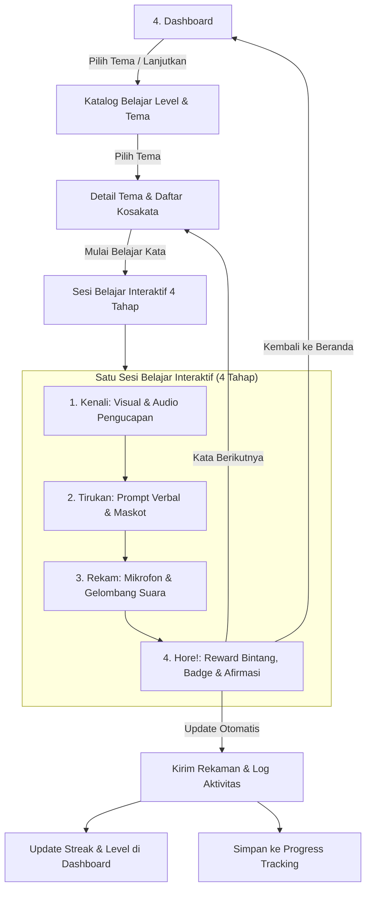

# 5. Learning Material

---

## 1. Description
Fitur **Learning Material** adalah modul pembelajaran interaktif anak bersama pendampingan orang tua. Modul ini dirancang bertahap per level perkembangan bicara melalui materi audio-visual yang kaya konteks kehidupan sehari-hari. 

Setiap materi disajikan dalam **Satu Sesi Belajar Utuh (4 Tahap)** yang menyatu tanpa perpindahan layar yang membingungkan:
$$\text{Kenali} \longrightarrow \text{Tirukan} \longrightarrow \text{Rekam} \longrightarrow \text{Hore!}$$

Anak diajak mengenali objek melalui visual dan suara, menirukan artikulasi kata, merekam suaranya secara mandiri dengan pendampingan, lalu menerima penghargaan positif (*positive reinforcement*) berupa bintang, lencana, dan kenaikan progres. Rekaman suara otomatis disimpan ke **Progress Tracking** sebagai arsip perkembangan anak.

---

## 2. Goals & UX Metrics
* **Goal Utama:**
  * Memberikan stimulasi bahasa terstruktur sesuai tahap kesiapan anak (*scaffolded learning*).
  * Menciptakan pengalaman belajar bicara yang menyenangkan, bebas rasa takut salah (*failure-free experience*), dan memotivasi anak untuk berani bersuara.
  * Mengintegrasikan proses latihan bicara langsung dengan perekaman audio otomatis (*voice recording*) untuk dokumentasi tanpa merepotkan orang tua.
* **UX Metrics:**
  * **Session Completion Rate:** $\ge 80\%$ anak yang memulai sesi menyelesaikan hingga tahap *Hore!*.
  * **Voice Interaction Rate:** $\ge 75\%$ anak mencoba menekan tombol mikrofon dan mengeluarkan rekaman suara minimal 1 kali per materi.
  * **Replay Rate:** Anak mendengarkan ulang rekaman suaranya sendiri minimal 1 kali setelah sesi selesai.

---

## 3. Constraints & Child-Friendly Principles
* **Pendampingan Orang Tua:** Fitur dirancang untuk dinikmati anak bersama orang tua (*co-viewing / co-learning*). Tersedia tips singkat panduan pendampingan untuk orang tua di setiap modul.
* **Prinsip Bebas Kegagalan (Zero-Penalty Experience):** Tidak ada status *"Jawaban Salah"* atau skor merah. Perekaman suara berfokus pada keberanian anak mencoba bersuara. Seluruh usaha mendapatkan apresiasi bintang.
* **Aksesibilitas & UI Ramah Anak:**
  * Ukuran tombol besar (minimal $\ge 56 \times 56\text{ dp}$) dengan ikon yang jelas dan sudut melengkung (*rounded corners*).
  * Kontras warna ramah anak dan animasi maskot yang ekspresif untuk mempertahankan fokus anak usia 2–6 tahun.
  * Navigasi sesi menggunakan *Progress Dots* sederhana di bagian atas.

---

## 4. User Flow & Alur 4 Tahap Sesi Belajar

---

## 5. UI Flow & Spesifikasi Komponen

### A. Layar Katalog Belajar (Katalog Level & Tema)
* **Header:** Judul *"Belajar Bicara"* + Avatar anak aktif (*Kayla*) + Ringkasan: *"Kayla sudah mempelajari 8 kata baru!"*
* **Selector Level Pembelajaran:**
  * Tab Level: **Level 1** (Aktif) · Level 2 · Level 3.
  * Indikator Progres Level: *"Level 1 (65% Selesai) – Eksplorasi Suara & Kata Pertama"*.
* **Grid Kartu Tema (Visual Ilustrasi Menarik):**
  * Setiap kartu menampilkan ilustrasi tema besar, nama tema, jumlah kata, dan progres (contoh: *2/4 Kata*).
  * **Badge "Rekomendasi":** Ditampilkan pada tema yang sesuai minat profil anak (contoh: *Tema Hewan Peliharaan* & *Ruang Tamu*).
  * **Status Tema:** Terbuka / Sedang Berjalan / Selesai (menampilkan lencana bintang emas).

---

### B. Layar Detail Tema & Daftar Kosakata
* **Header Tema:** Tombol Kembali + Nama Tema (*"🐶 Hewan Peliharaan"*) + Banner ilustrasi ceria.
* **Daftar Kartu Kosakata (Grid 2 Kolom):**
  * Kartu bergambar objek nyata/kartun ramah anak (contoh: *Kucing*, *Kelinci*, *Ayam*, *Ikan*).
  * Label status per kata:
    * *Selesai:* Centang hijau + 3 Bintang emas diraih.
    * *Sedang Dipelajari:* Highlight garis warna primer + ikon *play*.
    * *Belum Dipelajari:* Ikon gembok terbuka (dapat dipilih bebas).
* **CTA Bawah:**
  * Tombol *"Mulai Belajar Kata Berikutnya"* (otomatis memilih kata aktif yang belum selesai).

---

### C. Layar Sesi Belajar Interaktif (4 Tahap Berurutan)
Layar sesi belajar menggunakan antarmuka layar penuh (*full screen focus mode*) yang ramah anak dengan **Progress Dots (Kenali · Tirukan · Rekam · Hore!)** di bagian atas serta tombol keluar (tanda silang) di sudut kiri atas:

1. **Tahap 1: Kenali (Pengenalan Objek & Audio Asli)**
   * **Elemen:** Ilustrasi besar di tengah (misal: Gambar Kucing lucu), teks nama kata *"Kucing"*, dan maskot Celoteh menyapa: *"Yuk, dengarkan suaranya!"*
   * **Audio Otomatis:** Suara narasi jernih dan ramah melafalkan: *"Ini Kucing. Meong... Meong..."*
   * **Tombol Ulang Audio:** Ikon *speaker* berdenyut interaktif jika anak ingin mendengarkan suara lagi.
   * **Tombol Navigasi Bawah:** Tombol besar *"Lanjut"* dengan animasi panah ceria.

2. **Tahap 2: Tirukan (Prompt Verbal & Ajak Bersuara)**
   * **Elemen:** Animasi maskot membuka mulut mengajak bicara dengan teks balon kata: *"Sekarang giliranmu! Coba tirukan: Kucing!"*
   * **Instruksi untuk Orang Tua (Tips kecil di bawah):** *"Bunda dapat memberi contoh sambil tersenyum dan kontak mata dengan Kayla."*
   * **Tombol Bawah:** Tombol *"Aku Siap Bicara"* mengarahkan ke perekaman suara.

3. **Tahap 3: Rekam (Perekaman Suara Anak & Validasi Positif)**
   * **Elemen Utama:** Tombol Mikrofon Besar di tengah layar dengan animasi gelombang suara (*voice waveform*) warna-warni saat anak berbicara.
   * **Kontrol Perekaman:**
     * Ketuk tombol mikrofon untuk mulai merekam (timer visual lembut 5–10 detik).
     * Tombol *"Stop / Selesai"* setelah anak selesai berbicara.
   * **Umpan Balik Rekaman (Review State):**
     * Tombol *"Dengarkan Suaramu"* (ikon *play*) agar anak dan orang tua bisa mendengar kembali suaranya.
     * Tombol *"Coba Rekam Lagi"* (tanpa batas, tanpa penalti kesalahan).
   * **Afirmasi Positif:** Teks maskot: *"Hebat sekali! Suaramu terdengar jelas dan berani!"*
   * **Tombol Bawah:** Tombol *"Simpan & Lihat Hadiah"* $\rightarrow$ Menuju tahap Hore!

4. **Tahap 4: Hore! (Layar Reward & Selebrasi Hasil Belajar)**
   * **Animasi Selebrasi:** Konfeti ceria, animasi maskot meloncat gembira, dan efek bintang muncul (*1, 2, 3 Bintang Emas*).
   * **Pencapaian:**
     * *"Kamu berhasil mempelajari kata baru: Kucing!"*
     * Badge Tema bertambah: *"3 dari 4 kata selesai di Tema Hewan Peliharaan"*.
     * Streak Harian bertambah: *"🔥 5 Hari Latihan Berturut-turut!"*.
   * **Notifikasi Penyimpanan:** Keterangan ramah: *"✨ Rekaman suaramu sudah tersimpan di Catatan Progres Bunda."*
   * **Aksi Navigasi (Dual CTA):**
     * **Primary CTA:** Tombol *"Lanjut ke Kata Berikutnya (Kelinci)"*.
     * **Secondary CTA:** Tombol outline *"Kembali ke Daftar Tema"*.

---

## 6. Struktur Data Dummy Kurikulum Per Level

| Level | Tema | Daftar Subtema / Kosakata | Target Stimulasi |
| :--- | :--- | :--- | :--- |
| **Level 1: Eksplorasi Suara & Kata Pertama** | 🛋️ Ruang Tamu | Sofa, Meja, TV, Lampu | Pengenalan benda sekitar rumah, suku kata terbuka |
| | 🐶 Hewan Peliharaan | Kucing, Kelinci, Ayam, Ikan | Onomatope (suara hewan) & peniruan vokal |
| | 🍎 Buah-buahan | Apel, Pisang, Jeruk, Anggur | Kosakata makan & sensori visual |
| **Level 2: Kombinasi Kata & Aksi Sehari-hari** | 👨‍👩‍👧 Keluarga Tercinta | Ibu, Ayah, Kakak, Adik | Kata sapaan & interaksi sosial |
| | 🍽️ Makan & Minum | Nasi, Susu, Air, Roti | Frasa kebutuhan dasar (*"Mau Susu"*, *"Makan Nasi"*) |
| | 👕 Pakaian & Diri | Baju, Celana, Sepatu, Topi | Kata benda personal & rutinitas mandiri |
| **Level 3: Kalimat Sederhana & Cerita Ekspresif** | 🏥 Pekerjaan Sekitar | Dokter, Guru, Polisi, Petani | Kalimat 3 kata & konsep peran (*"Pak Dokter tolong anak"*) |
| | 🌳 Taman & Alam | Pohon, Bunga, Burung, Matahari | Kalimat deskriptif & observasi lingkungan |

---

## 7. Hubungan dengan Modul Fitur Lain
* **Hubungan dengan `PRD.md`:** Mewujudkan fungsi inti aplikasi sebagai media stimulasi interaktif berbasis audio-visual dan gamifikasi non-hukuman.
* **Hubungan dengan `3. Child Profile.md`:** Menggunakan preferensi minat dan rekomendasi level dari skrining awal untuk memprioritaskan tema yang ditampilkan.
* **Hubungan dengan `4. Dashboard.md`:** 
  * Diinisiasi dari tombol *"Lanjutkan Belajar"* atau *Kartu Rekomendasi Tema*.
  * Setiap sesi yang selesai mengupdate persentase *Learning Level Overview* dan memperbarui *Daily Streak*.
* **Hubungan dengan `6. Progress Tracking.md`:** 
  * Rekaman audio anak dari Tahap 3 otomatis tersimpan ke **Voice Recording History**.
  * Waktu dan hasil penyelesaian sesi dicatat ke dalam **Activity History**.
  * Jumlah kata yang dipelajari meningkatkan metrik *Language Development* & *Verbal Expression*.
