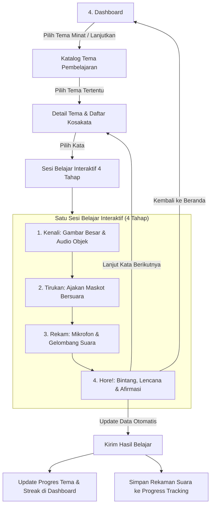

# 5. Learning Material

---

## 1. Description
Fitur **Learning Material** adalah pusat pembelajaran interaktif anak bersama orang tua yang dirancang **berbasis tema minat anak (*interest-driven learning*)**. Di Celoteh, materi tidak dikunci dalam tingkatan level kaku, melainkan disajikan dalam ragam tema menarik yang akrab dengan keseharian si kecil (hewan, kendaraan, buah, benda di rumah, dinosaurus, dan keluarga).

Setiap kata dalam tema dipelajari melalui **Satu Sesi Belajar Interaktif (4 Tahap)** yang menyenangkan:
$$\text{Kenali} \longrightarrow \text{Tirukan} \longrightarrow \text{Rekam} \longrightarrow \text{Hore!}$$

Anak diajak mengenali objek lewat gambar dan suara, menirukan artikulasi kata, merekam suaranya secara mandiri dengan pendampingan, lalu merayakan keberaniannya melalui bintang dan lencana. Rekaman suara otomatis disimpan ke **Progress Tracking** agar orang tua dapat mendengarkan kembali perjalanan komunikasi anak.

---

## 2. Goals & UX Metrics
* **Goal Utama:**
  * Membangun stimulasi bicara yang alami dan antusias melalui topik-topik yang paling disukai anak.
  * Memberikan pengalaman latihan bicara yang bebas rasa takut salah (*failure-free experience*) sehingga anak berani bersuara.
  * Menggabungkan media visual, audio narasi, dan rekaman suara langsung dalam satu alur yang mengalir tanpa menu yang rumit.
* **UX Metrics:**
  * **Session Completion Rate:** $\ge 80\%$ anak menyelesaikan sesi 4 tahap hingga layar *Hore!*.
  * **Voice Participation Rate:** $\ge 75\%$ anak mencoba menekan tombol mikrofon dan bersuara minimal 1 kali per kata.
  * **Voluntary Repeat Rate:** Anak atau orang tua memutar ulang suara sendiri setelah sesi selesai.

---

## 3. Constraints & Child-Friendly Principles
* **Bebas Eksplorasi Minat (Tanpa Kunci Level):** Semua tema terbuka untuk dieksplorasi sesuai minat anak pada hari tersebut, dengan rekomendasi tema favorit dari profil anak.
* **Prinsip Bebas Kegagalan (*Zero-Penalty*):** Tidak ada istilah salah atau gagal. Setiap usaha anak menekan tombol mikrofon dan mengeluarkan celoteh atau kata diapresiasi secara positif.
* **Desain UI Ramah Anak (Usia 2–6 Tahun):**
  * Elemen interaktif dan tombol berukuran besar (mudah disentuh jari kecil anak).
  * Ilustrasi cerah, teks minimal, dan animasi maskot yang ekspresif.
  * Navigasi sederhana menggunakan indikator tahapan (*progress dots*) di bagian atas.

---

## 4. User Flow & Alur 4 Tahap Sesi Belajar

---

## 5. UI Flow & Spesifikasi Komponen

### A. Layar Katalog Tema Pembelajaran
* **Header:** Judul *"Belajar Bicara"* + Avatar anak (*Kayla*) + Teks sapaan: *"Pilih tema yang disukai Kayla hari ini!"*
* **Kategori Tema Favorit (Pin Rekomendasi Profil):**
  * Tema yang dipilih saat pengisian *Child Profile* diberi badge khusus: *"⭐ Favorit Kayla"*.
* **Grid Kartu Tema Bergambar (Visual Besar & Menarik):**
  * Setiap kartu menampilkan gambar tema yang hidup, judul tema, jumlah kata, dan progres belajar (contoh: *3/5 Kata Dicoba*).
  * Mengetuk kartu tema membuka halaman daftar kata dalam tema tersebut.

---

### B. Layar Detail Tema & Daftar Kosakata
* **Header Tema:** Tombol Kembali + Judul Tema (*"🐶 Hewan Peliharaan"*) + Banner ilustrasi ceria.
* **Daftar Kartu Kosakata (Grid 2 Kolom):**
  * Kartu bergambar objek nyata/kartun lucu (contoh: *Kucing*, *Kelinci*, *Ayam*, *Ikan*, *Burung*).
  * Status per kata:
    * *Sudah Dicoba:* Centang hijau + 3 Bintang emas diraih.
    * *Sedang Berjalan:* Highlight warna ceria + ikon *play*.
    * *Siap Dipelajari:* Dapat langsung diketuk untuk memulai.
* **Tombol Aksi Bawah:**
  * Tombol *"Mulai Belajar Kata Berikutnya"* (otomatis memilih kata yang belum dicoba).

---

### C. Layar Sesi Belajar Interaktif (4 Tahap Berurutan)
Layar sesi belajar menggunakan tampilan layar penuh (*full screen*) yang bersih dengan **Progress Dots (Kenali · Tirukan · Rekam · Hore!)** di bagian atas serta tombol keluar (X) di kiri atas:

1. **Tahap 1: Kenali (Visual & Pengucapan Jelas)**
   * **Elemen:** Ilustrasi besar di tengah (misal: Gambar Kucing tersenyum), tulisan teks kata *"Kucing"*, dan maskot Celoteh yang menyapa ramah.
   * **Audio Otomatis:** Suara narasi jernih dan hangat: *"Ini Kucing. Meong... Meong..."*
   * **Tombol Putar Ulang Audio:** Ikon speaker besar interaktif jika anak ingin mendengarkan suaranya lagi.
   * **Tombol Bawah:** Tombol besar *"Lanjut"* dengan animasi panah ceria.

2. **Tahap 2: Tirukan (Ajakan Bersuara)**
   * **Elemen:** Maskot Celoteh membuka mulut mengajak bicara dengan balon kata: *"Sekarang giliranmu! Yuk tirukan: Kucing!"*
   * **Tips Pendampingan Orang Tua:** Teks kecil di bawah: *"Bunda dapat memberi contoh sambil tersenyum dan kontak mata dengan Kayla."*
   * **Tombol Bawah:** Tombol *"Aku Siap Bicara"* mengarahkan ke perekaman suara.

3. **Tahap 3: Rekam (Latihan Suara & Apresiasi)**
   * **Elemen Utama:** Tombol Mikrofon Besar di tengah layar dengan animasi gelombang suara (*voice waveform*) warna-warni saat anak bersuara.
   * **Kontrol Rekaman:**
     * Ketuk mikrofon untuk mulai merekam (dengan timer visual lembut).
     * Tombol *"Selesai"* setelah anak berbicara.
   * **Pilihan Ulang:**
     * Tombol *"Dengarkan Suaramu"* (ikon putar) agar anak bisa mendengar suaranya sendiri.
     * Tombol *"Coba Rekam Lagi"* (tanpa batas, tanpa rasa bersalah).
   * **Pesan Positif:** Teks maskot: *"Hebat sekali! Suaramu terdengar jelas dan berani!"*
   * **Tombol Bawah:** Tombol *"Simpan & Lihat Hadiah"*.

4. **Tahap 4: Hore! (Layar Perayaan & Hadiah)**
   * **Visual Selebrasi:** Efek konfeti gembira, animasi maskot melompat, dan efek 3 bintang emas muncul.
   * **Pencapaian:**
     * *"Hebat! Kayla berhasil mencoba kata baru: Kucing!"*
     * Progres tema bertambah: *"3 dari 5 kata selesai di Tema Hewan Peliharaan"*.
     * Streak bertambah: *"🔥 5 Hari Latihan Rutin!"*.
   * **Keterangan Ramah:** *"✨ Rekaman suara Kayla sudah tersimpan di Catatan Progres Bunda."*
   * **Navigasi Bawah (Dual Action):**
     * **Tombol Utama:** *"Lanjut Kata Berikutnya (Kelinci)"*.
     * **Tombol Sekunder:** *"Kembali ke Daftar Tema"*.

---

## 6. Contoh Ragam Tema Minat & Kosakata

| Tema Minat | Pilihan Kosakata / Objek | Fokus Stimulasi Bahasa |
| :--- | :--- | :--- |
| 🐶 **Hewan Peliharaan** | Kucing, Kelinci, Ayam, Ikan, Burung | Tiruan suara hewan (*onomatope*) & vokal ceria |
| 🍎 **Buah & Makanan** | Apel, Pisang, Jeruk, Nasi, Susu, Roti | Kosakata kebutuhan makan sehari-hari |
| 🚗 **Kendaraan & Transportasi**| Mobil, Kereta, Pesawat, Motor, Sepeda | Suara mesin, kata aksi, dan minat gerak |
| 🛋️ **Benda di Rumah** | Sofa, Meja, TV, Lampu, Kasur | Mengenal lingkungan sekitar kamar dan ruang tamu |
| 🦖 **Dinosaurus & Alam** | Dino, Pohon, Bunga, Bintang, Air | Memancing imajinasi dan rasa ingin tahu anak |
| 👨‍👩‍👧 **Keluarga Tercinta** | Ibu, Ayah, Kakak, Adik, Nenek | Kata sapaan keluarga dan interaksi sosial harian |

---

## 7. Hubungan dengan Modul Fitur Lain
* **Hubungan dengan `PRD.md`:** Mewujudkan sesi belajar interaktif 4 tahap berbasis minat anak.
* **Hubungan dengan `3. Child Profile.md`:** Memprioritaskan tema yang ditandai sebagai minat favorit anak saat pengisian profil.
* **Hubungan dengan `4. Dashboard.md`:** 
  * Dibuka dari tombol *"Lanjutkan Belajar"* atau pemilihan kartu tema di Dashboard.
  * Menyelesaikan sesi belajar memperbarui progres tema dan menambah streak harian di Dashboard.
* **Hubungan dengan `6. Progress Tracking.md`:** 
  * Rekaman suara dari Tahap 3 otomatis tersimpan ke **Arsip Rekaman Suara**.
  * Kata yang berhasil dipelajari langsung tercatat pada **Riwayat Aktivitas** dan **Capaian Kosakata**.
