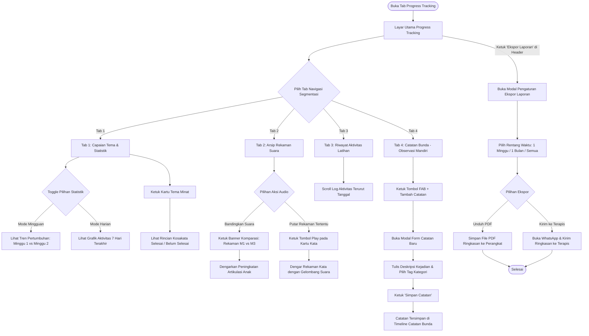

# 6. Progress Tracking

## Description
Fitur yang memungkinkan orang tua atau pengasuh memantau perkembangan stimulasi bicara anak melalui pencatatan perbendaharaan kata berdasarkan tema minat. Sistem menampilkan visualisasi statistik pertumbuhan kata dengan toggle harian dan mingguan, rincian materi yang telah dicoba, arsip rekaman suara anak, catatan observasi harian orang tua, serta fitur ekspor laporan ringkas yang dapat dibagikan kepada terapis wicara.

## Goal
* Membantu orang tua memantau perkembangan kosakata anak per tema minat secara berkala.
* Menyajikan visualisasi statistik pertumbuhan kosakata anak yang mudah dipahami melalui toggle harian dan mingguan (misal perbandingan minggu lalu 10 kata vs minggu ini 16 kata).
* Mendokumentasikan riwayat latihan dan arsip rekaman suara anak dari waktu ke waktu.
* Membantu orang tua mengetahui konsistensi aktivitas stimulasi bicara anak di rumah.
* Menampung catatan observasi mandiri orang tua saat anak berinteraksi spontan di rumah.
* Menyediakan ringkasan perkembangan yang dapat dibagikan kepada terapis wicara dengan mudah.

## Constraint
* Fitur diakses oleh orang tua atau pengasuh yang memiliki akun dan profil anak.
* Data progres dihitung berdasarkan kata yang diselesaikan pada tema-tema Learning Material.
* Berbasis tema minat dan perbendaharaan kata, bukan ukuran nilai level atau intelegensi anak.
* Sistem tidak memberikan diagnosis medis; seluruh data disajikan sebagai dokumentasi latihan di rumah.
* Data progres ditampilkan spesifik berdasarkan profil anak yang sedang dipilih.

## Flow
Dashboard / Bottom Nav → Progress Tracking → Pilih Tab (Capaian Tema / Arsip Suara / Riwayat / Catatan) → Putar Rekaman / Tambah Catatan / Ekspor Laporan

## User Flow

### Rincian Langkah User Flow
1. **Titik Masuk (Entry Point):** Pengguna masuk melalui tab *Progres* pada Bottom Navigation Bar atau mengetuk *"Lihat Selengkapnya"* dari Dashboard.
2. **Alur 1: Memantau Statistik Perkembangan Kata (Tab Capaian Tema):**
   * Pengguna beralih antara toggle switch **"Harian"** dan **"Mingguan"**:
     * *Mode Mingguan:* Pengguna melihat tren pertumbuhan kata kumulatif (misal: *Minggu 1: 10 kata $\rightarrow$ Minggu 2: 16 kata* dengan indikator kenaikan $+60\%$).
     * *Mode Harian:* Pengguna melihat grafik konsistensi 7 hari latihan terakhir dan durasi rata-rata harian.
   * Pengguna dapat mengetuk kartu tema (misal: *Tema Hewan Peliharaan*) untuk memeriksa kata-kata apa saja yang sudah berhasil dicoba anak.
3. **Alur 2: Mendengarkan Arsip Rekaman & Komparasi Suara (Tab Arsip Suara):**
   * Pengguna mengetuk banner komparasi untuk mendengarkan perubahan pelafalan anak antara rekaman pertama (minggu ke-1) dan rekaman terbaru (minggu ke-3).
   * Pengguna menjelajahi daftar rekaman kronologis dan memutar audio rekaman kata tertentu menggunakan mini audio player.
4. **Alur 3: Meninjau Riwayat Aktivitas Latihan (Tab Riwayat Aktivitas):**
   * Pengguna menggulir timeline log untuk melihat tanggal latihan, materi kata yang dipelajari, durasi sesi, dan bintang reward yang didapatkan anak.
5. **Alur 4: Mencatat Observasi Harian (Tab Catatan Bunda):**
   * Pengguna mengetuk tombol mengambang (*FAB: + Tambah Catatan*) $\rightarrow$ Mengetikkan catatan spontan anak di rumah (misal: *"Kayla menunjuk kucing di jalan dan bilang 'Cing!'"*) $\rightarrow$ Memilih tag kategori (*Kosakata Baru*) $\rightarrow$ Mengetuk *"Simpan Catatan"*.
6. **Alur 5: Ekspor Laporan untuk Terapis Wicara:**
   * Pengguna mengetuk ikon bagikan / tombol *"Ekspor Laporan"* di sudut kanan atas header.
   * Pengguna memilih periode laporan (1 minggu / 1 bulan / semua) $\rightarrow$ Memilih opsi *"Unduh Ringkasan PDF"* untuk dicetak atau *"Kirim ke WhatsApp Terapis"* untuk konsultasi daring.

## UI Flow
Header Progress Tracking
Judul Halaman: “Perkembangan Bicara”.
Child Profile Switcher: Avatar dan nama anak aktif (“Kayla, 3 th”) dengan dropdown ganti profil anak.
Tombol Aksi Kanan Atas: Ikon bagikan / “Ekspor Laporan”.

Tab Navigasi Segmentasi
4 pilihan tab navigasi:
- Capaian Tema (Ringkasan kosakata per tema minat)
- Arsip Suara (Riwayat dan pemutar rekaman suara anak)
- Riwayat Aktivitas (Log waktu dan aktivitas latihan)
- Catatan Bunda (Observasi harian orang tua)

Tab 1: Capaian Tema (Progres Kosakata Berdasarkan Minat)
Visual Statistik Perkembangan Kata (Toggle Harian / Mingguan)
Toggle switch pilihan periode: “Harian” | “Mingguan”.
Tampilan Mode Mingguan (Tren Pertumbuhan Kosakata):
- Grafik batang perbandingan pertumbuhan kata per minggu (contoh: Minggu 1: 10 kata → Minggu 2: 16 kata).
- Indikator kenaikan: “🎉 +6 Kata Baru Minggu Ini (+60% peningkatan)”.
- Keterangan pencapaian: “Kayla konsisten menambah kosakata baru setiap minggunya.”
Tampilan Mode Harian (Aktivitas Latihan per Hari):
- Grafik batang 7 hari terakhir (Sen: 2 kata, Sel: 3 kata, Rab: 2 kata, Kam: 4 kata, Jum: 2 kata, Sab: 3 kata, Min: 0 kata).
- Rata-rata durasi latihan: 8 menit/hari.

Ringkasan Total Kosakata
Kartu sorotan: “16 Kata Telah Dicoba”.

Daftar Tema Minat dan Progres Kata
- 🐶 Tema Hewan Peliharaan: 5 dari 5 kata selesai (100%) – Lencana Selesai.
- 🍎 Tema Buah & Makanan: 4 dari 6 kata selesai (66%).
- 🚗 Tema Kendaraan: 4 dari 5 kata selesai (80%).
- 🛋️ Tema Benda di Rumah: 3 dari 5 kata selesai (60%).
Kartu tema dapat diketuk untuk melihat detail kata yang sudah dan belum dicoba.

Tab 2: Arsip Suara (Riwayat Rekaman Suara)
Fitur Komparasi Suara: Banner “Dengarkan Perubahan Suara Kayla” dengan dua tombol audio berdampingan:
- Rekaman Pertama: Kata “Kucing” (Minggu ke-1).
- Rekaman Terbaru: Kata “Kucing” (Minggu ke-3).
Daftar rekaman suara terurut kronologis:
- Ikon dan nama kata: “Kucing · Tema Hewan Peliharaan”.
- Tanggal dan waktu: “Hari ini, 09.32 WIB”.
- Mini Audio Player: Tombol Play/Pause, visual gelombang suara (waveform), dan durasi audio (0:04).
- Apresiasi bintang yang diperoleh: ⭐⭐⭐.

Tab 3: Riwayat Aktivitas (Activity Log)
Timeline aktivitas terurut tanggal (“Hari ini”, “Kemarin”).
Daftar aktivitas:
- Ikon materi selesai.
- Judul: “Menyelesaikan Latihan: Kucing”.
- Durasi: “6 menit”.
- Hasil: “Mendapatkan 3 Bintang & Memperpanjang Streak ke-5”.

Tab 4: Catatan Bunda (Observasi Orang Tua)
Tombol FAB (+ Tambah Catatan).
Form modal tambah catatan:
- Tanggal observasi.
- Input teks catatan: (contoh: "Sore ini Kayla spontan menunjuk kucing di teras dan berkata 'Cing! Meong'").
- Tag kategori: Kosakata Baru, Respons Panggilan, Menirukan Suara, Gestur Mandiri.
- Tombol Simpan Catatan.
Daftar catatan observasi tersimpan lengkap dengan tanggal dan tag warna.

Ekspor Laporan untuk Terapis
Tombol “Ekspor Laporan” di header membuka modal ekspor.
Pilihan rentang waktu: 1 Minggu Terakhir / 1 Bulan Terakhir / Semua Periode.
Rincian yang disertakan: Grafik statistik pertumbuhan kata, ringkasan tema yang dilatih, frekuensi latihan, dan transkrip catatan observasi orang tua.
Tombol “Unduh Ringkasan PDF”.
Tombol “Kirim ke WhatsApp Terapis”.

## Hubungan Antar Fitur
* Data profil anak terhubung dengan **3. Child Profile** dan pemilih profil anak di header.
* Menyuplai data ringkasan metrik kosakata dan grafik statistik ke **4. Dashboard**.
* Menerima kiriman rekaman suara otomatis dan log penyelesaian dari **5. Learning Material**.
