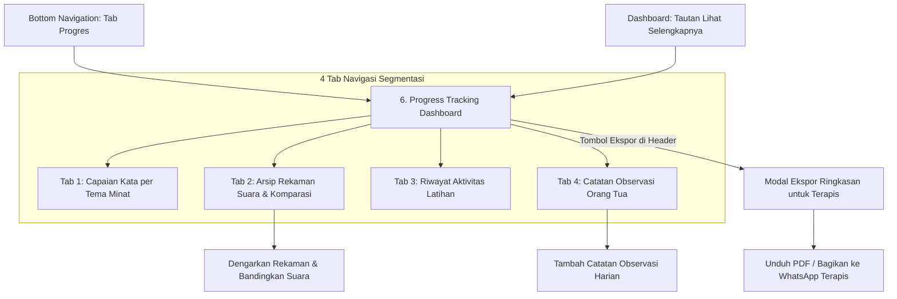

# 6. Progress Tracking

---

## 1. Description
Fitur **Progress Tracking** adalah pusat pemantauan dan dokumentasi perkembangan stimulasi bicara anak yang dirancang untuk orang tua. Di halaman ini, orang tua dapat melihat kata-kata yang telah dicoba anak **berdasarkan tema minat**, memutar kembali arsip rekaman suara si kecil dari waktu ke waktu, mencatat momen perkembangan spontan di rumah, serta mengekspor ringkasan latihan untuk didiskusikan bersama terapis wicara.

---

## 2. Goals & UX Metrics
* **Goal Utama:**
  * Memberikan gambaran nyata dan mudah dipahami mengenai perbendaharaan kata anak yang berkembang melalui tema-tema yang disukainya.
  * Menyimpan rekaman suara anak secara teratur agar orang tua dapat mendengarkan kembali peningkatan keberanian bicara dan kejelasan artikulasi anak (*audio progress history*).
  * Menyediakan sarana pencatatan observasi mandiri dan laporan ringkas yang siap dibagikan kepada terapis wicara.
* **UX Metrics:**
  * **Feature Check Rate:** $\ge 60\%$ orang tua membuka tab Progress Tracking setidaknya satu kali seminggu.
  * **Audio Replay Engagement:** $\ge 50\%$ orang tua mendengarkan kembali arsip rekaman suara anak di tab rekaman.
  * **Therapist Sharing:** Orang tua memanfaatkan fitur ekspor ringkasan saat jadwal konsultasi.

---

## 3. Constraints & Principles
* **Berbasis Minat & Kosakata, Bukan Level:** Progres dihitung berdasarkan kata-kata yang telah dilatih pada setiap tema minat, bukan penilaian angka level yang membebani.
* **Fokus Dokumentasi Kebiasaan:** Data disajikan sebagai arsip pendampingan latihan di rumah, bukan diagnosis medis atau tolok ukur klinis anak.
* **Konteks Profil Anak Aktif:** Seluruh grafik dan arsip rekaman disaring sesuai anak yang dipilih pada *Child Switcher* di header.

---

## 4. User Flow

---

## 5. UI Flow & Spesifikasi Komponen

### A. Header & Top Bar
* **Judul Halaman:** *"Perkembangan Bicara"*
* **Pengalih Profil Anak (Child Switcher):** Menampilkan nama dan avatar anak aktif (*Kayla, 3 th*) dengan ikon dropdown untuk berganti anak.
* **Tombol Aksi Kanan Atas:** Ikon bagikan / *"Ekspor Laporan"* untuk mengirim ringkasan latihan ke terapis wicara.

---

### B. Tab Segmentasi Navigasi (Segmented Control)
Tersedia 4 tab menu atas yang mudah dijangkau:
1. **Capaian Tema** (Ringkasan Kosakata per Minat)
2. **Arsip Suara** (Pemutar Audio Rekaman Anak)
3. **Riwayat Aktivitas** (Log Waktu Latihan)
4. **Catatan Bunda** (Observasi Harian)

---

### C. Spesifikasi Tab 1: Capaian Kata per Tema Minat
* **Konsistensi Latihan Mingguan:**
  * Grafik batang 7 hari terakhir: *"5 Hari Latihan Minggu Ini (Rata-rata 8 menit/hari)"*.
* **Ringkasan Total Kosakata:**
  * Kartu sorotan: *"14 Kata Telah Dicoba"* dari berbagai tema yang disukai Kayla.
* **Daftar Progres Berdasarkan Tema Minat:**
  * Kartu tema dengan visual dan progres kata:
    * 🐶 **Tema Hewan Peliharaan:** 4 dari 5 kata selesai (80%) – Kucing, Kelinci, Ayam, Ikan.
    * 🍎 **Tema Buah & Makanan:** 3 dari 6 kata selesai (50%) – Apel, Pisang, Susu.
    * 🚗 **Tema Kendaraan:** 2 dari 5 kata selesai (40%) – Mobil, Kereta.
    * 🛋️ **Tema Benda di Rumah:** 1 dari 5 kata selesai (20%) – Sofa.
  * Mengetuk salah satu tema membuka rincian kata yang sudah maupun belum dicoba.

---

### D. Spesifikasi Tab 2: Arsip Rekaman Suara (Audio Player & Komparasi)
* **Fitur Highlight: Komparasi Perkembangan Suara:**
  * Banner pembanding: *"Dengarkan Perubahan Suara Kayla"*
  * Dua tombol audio berdampingan:
    * *Rekaman Pertama:* Kata "Kucing" (Minggu ke-1).
    * *Rekaman Terbaru:* Kata "Kucing" (Minggu ke-3).
    * Menunjukkan peningkatan kejelasan artikulasi dan rasa percaya diri anak.
* **Daftar Rekaman Suara Terbaru (Bisa difilter per tema):**
  * Setiap kartu rekaman memuat:
    * Ikon dan nama kata: *"Kucing (Tema Hewan)"*.
    * Waktu perekaman: *"Hari ini, 09.32 WIB"*.
    * **Mini Audio Player:** Tombol Play/Pause, visual gelombang suara (*waveform*), durasi audio (0:04).
    * Apresiasi bintang yang diperoleh: ⭐⭐⭐.

---

### E. Spesifikasi Tab 3: Riwayat Aktivitas Latihan
* **Timeline Aktivitas Terurut Tanggal:**
  * Pengelompokan: *"Hari ini, 14 November 2026"*, *"Kemarin, 13 November 2026"*.
  * Setiap entri menampilkan:
    * Ikon aktivitas latihan.
    * Judul aktivitas: *"Latihan Menirukan & Rekam: Kucing"*.
    * Durasi sesi: *"6 menit"*.
    * Keterangan: *"Selesai dengan 3 Bintang & Memperpanjang Streak ke-5"*.

---

### F. Spesifikasi Tab 4: Catatan Observasi Orang Tua
* **Tujuan:** Tempat orang tua mencatat perkembangan spontan anak di luar penggunaan aplikasi.
* **Tombol Tambah Catatan:** Tombol mengambang (*FAB: + Tambah Catatan*).
* **Formulir Catatan (Bottom Sheet / Modal):**
  * Tanggal kejadian.
  * Deskripsi kejadian: *(contoh: "Sore ini Kayla spontan menunjuk kucing tetangga dan berkata 'Cing! Meong' dengan gembira!")*.
  * Pilihan Tag Kategori: *Kosakata Baru* · *Respons Nama* · *Menirukan Suara* · *Gestur Mandiri*.
  * Tombol *"Simpan Catatan"*.
* **Tampilan Catatan Tersimpan:** Kartu rapi menampilkan tanggal, tag warna kategori, dan isi observasi orang tua.

---

### G. Fitur Ekspor Ringkasan Latihan untuk Terapis
* **Akses:** Dibuka melalui tombol *"Ekspor Laporan"* di bagian atas.
* **Modal Ekspor Sederhana:**
  * Pilihan periode: *1 Minggu Terakhir / 1 Bulan Terakhir / Semua*.
  * Ringkasan yang dicakup: Daftar tema dan kata yang dilatih, frekuensi latihan, dan catatan observasi orang tua.
* **Tombol Tindakan:**
  * **"Unduh Ringkasan PDF"** (dokumen satu halaman bersih untuk dibawa saat terapi).
  * **"Kirim ke WhatsApp Terapis"** (berbagi ringkasan teks dan tautan file dengan mudah).

---

## 6. Hubungan dengan Modul Fitur Lain
* **Hubungan dengan `PRD.md`:** Menjadi sarana dokumentasi terstruktur untuk memantau hasil stimulasi bicara berbasis minat anak.
* **Hubungan dengan `3. Child Profile.md`:** Terhubung dengan *Child Switcher* dan menggunakan nama serta preferensi minat anak aktif.
* **Hubungan dengan `4. Dashboard.md`:** 
  * Menyuplai angka ringkasan kosakata dan aktivitas terakhir di Dashboard.
  * Tautan *"Lihat Selengkapnya"* di Dashboard langsung membuka tab ini.
* **Hubungan dengan `5. Learning Material.md`:** 
  * Rekaman suara dari sesi belajar otomatis masuk ke *Tab Arsip Suara*.
  * Sesi latihan yang selesai otomatis menambah daftar kata pada *Tab Capaian Tema*.
