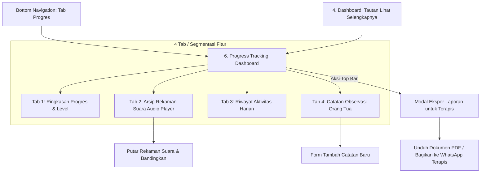

# 6. Progress Tracking

---

## 1. Description
Fitur **Progress Tracking** adalah pusat pemantauan dan dokumentasi perkembangan stimulasi bicara anak yang dikhususkan bagi orang tua atau pengasuh. Fitur ini secara otomatis menghimpun data aktivitas dari modul **Learning Material**—mencakup persentase penyelesaian materi per level, frekuensi latihan harian, serta arsip rekaman suara anak.

Selain data kuantitatif otomatis, orang tua dapat menambahkan **Catatan Observasi Mandiri** mengenai perkembangan komunikasi anak dalam kehidupan sehari-hari, serta memanfaatkan fitur **Ekspor Ringkasan Perkembangan** untuk dikonsultasikan secara langsung kepada terapis wicara atau dokter anak.

---

## 2. Goals & UX Metrics
* **Goal Utama:**
  * Memberikan visibilitas yang objektif dan transparan mengenai perjalanan belajar dan konsistensi stimulasi bicara anak di rumah.
  * Mendokumentasikan arsip rekaman suara artikulasi anak dari waktu ke waktu agar orang tua dapat mendengarkan perubahan pelafalan secara nyata (*audio progress journey*).
  * Menjembatani kolaborasi antara orang tua dengan terapis wicara melalui laporan berkala yang terstruktur dan mudah dipahami tanpa klaim diagnostik.
* **UX Metrics:**
  * **Feature Engagement:** $\ge 60\%$ orang tua aktif membuka tab Progress Tracking setidaknya 1 kali per minggu.
  * **Audio Playback Rate:** $\ge 50\%$ orang tua memutar ulang rekaman suara anak di tab riwayat rekaman.
  * **Parent Observation Logging:** Minimal 1 catatan observasi kualitatif ditambahkan orang tua setiap 2 minggu.

---

## 3. Constraints & Ethical Principles
* **Batasan Medis & Non-Diagnostik (Medical Disclaimer):**
  * Seluruh grafik persentase dan riwayat rekaman disajikan sebagai **dokumentasi stimulasi kebiasaan harian**, bukan penilaian kecerdasan atau diagnosis klinis keterlambatan bicara.
  * Pada antarmuka dicantumkan catatan: *"Data ini mencerminkan aktivitas latihan di rumah. Untuk evaluasi klinis dan terapi wicara formal, selalu konsultasikan dengan profesional."*
* **Privasi Rekaman Suara:**
  * Rekaman suara anak disimpan dalam repositori privat yang terenkripsi dan hanya dapat diakses oleh akun orang tua yang bersangkutan.
  * Fitur berbagi laporan (*Export/Share Report*) memerlukan konfirmasi persetujuan orang tua (*explicit parental consent*).
* **Multi-Child Profile Context:**
  * Semua data tracking disaring berdasarkan profil anak yang sedang aktif (*Active Child Context*). Mengganti anak melalui pemilih profil di header akan otomatis memperbarui seluruh visualisasi data.

---

## 4. User Flow

---

## 5. UI Flow & Spesifikasi Komponen

### A. Header & Top Bar
* **Judul Halaman:** *"Perkembangan Si Kecil"*
* **Child Profile Selector:** Menampilkan avatar dan nama anak aktif (*Kayla, 3 th*) dengan ikon dropdown untuk beralih profil anak.
* **Tombol Aksi Utama (Top Right):** Tombol ikon bagikan / *"Ekspor Laporan"* (membuka fitur bagikan ringkasan ke terapis).

---

### B. Tab Navigasi Segmentasi (Segmented Control)
Memudahkan orang tua beralih fokus informasi:
1. **Ringkasan (Overview & Level)**
2. **Rekaman Suara (Audio History)**
3. **Riwayat Belajar (Activity Log)**
4. **Catatan Bunda (Parent Notes)**

---

### C. Spesifikasi Tab 1: Ringkasan Progres & Level (Overview & Level Progress)
* **Kartu Konsistensi Mingguan:**
  * Grafik batang frekuensi latihan 7 hari terakhir (contoh: *5 hari latihan, rata-rata 8 menit/hari*).
  * Status konsistensi: *"Status: Sangat Rutin 🔥"*.
* **Ringkasan Kosakata Tercapai:**
  * Kartu metrik: *"12 Kata Dikuasai"* · *"4 Kata Dalam Proses"* · *"3 Tema Selesai"*.
* **Visualisasi Progres Kurikulum Per Level:**
  * **Level 1: Eksplorasi Suara & Kata Pertama:** 
    * Progress bar besar: *8/12 Kosakata (65% Selesai)*.
    * Rincian status tema:
      * *🛋️ Ruang Tamu:* Selesai (4/4 kata) – Badge Emas ⭐.
      * *🐶 Hewan Peliharaan:* Berjalan (3/4 kata) – Bintang aktif.
      * *🍎 Buah-buahan:* Belum dimulai (0/4 kata).
  * **Level 2: Kombinasi Kata & Aksi Sehari-hari:** Terkunci (terbuka otomatis saat Level 1 mencapai 100%).
  * **Level 3: Kalimat Sederhana & Cerita Ekspresif:** Terkunci.

---

### D. Spesifikasi Tab 2: Arsip Rekaman Suara (Voice Recording History)
* **Tujuan:** Memungkinkan orang tua mendengarkan kembali perkembangan kejelasan vokal dan keberanian bicara anak.
* **Komponen Pembanding Audio (Highlight Fitur UX):**
  * Banner mini: *"Dengarkan Perubahan Artikulasi Kayla"*
  * Fitur komparasi dua tombol audio berdampingan:
    * *Rekaman Pertama:* Kata "Kucing" (Minggu ke-1).
    * *Rekaman Terbaru:* Kata "Kucing" (Minggu ke-3).
* **Daftar Arsip Rekaman (Urutan Kronologis Terkini):**
  * Kartu item rekaman:
    * Nama kata & tema: *"Kucing (Tema Hewan Peliharaan)"*.
    * Tanggal & waktu: *"Hari ini, 09.32 WIB"*.
    * **Mini Audio Player:** Tombol Play/Pause, visual gelombang audio (*audio waveform*), dan durasi rekaman (0:04).
    * Bintang apresiasi sesi: ⭐⭐⭐ (3 Bintang).

---

### E. Spesifikasi Tab 3: Riwayat Aktivitas Harian (Activity History)
* **Tujuan:** Menampilkan catatan log aktivitas belajar secara transparan.
* **Timeline Aktivitas:**
  * Dikelompokkan per tanggal: *"Hari ini, 14 November 2026"*, *"Kemarin, 13 November 2026"*.
  * Setiap entri menampilkan:
    * Ikon aktivitas (Materi Selesai / Latihan Suara).
    * Judul materi: *"Menyelesaikan Sesi Belajar: Sofa"*.
    * Durasi latihan: *"6 menit"*.
    * Hasil apresiasi: *"Mendapatkan 3 Bintang & Memperpanjang Streak ke-5"*.

---

### F. Spesifikasi Tab 4: Catatan Observasi Orang Tua (Development Notes)
* **Tujuan:** Menampung pengamatan kualitatif orang tua saat anak berinteraksi secara spontan di luar sesi aplikasi.
* **Tombol Tambah Catatan:** Tombol mengambang (*FAB: + Catatan Baru*).
* **Formulir Tambah Catatan (Bottom Sheet / Modal):**
  * Tanggal kejadian (default: hari ini).
  * Input teks deskripsi observasi: *(contoh: "Sore ini Kayla spontan menunjuk kucing di teras rumah dan mengucapkan kata 'Cing! Meong' tanpa diminta.")*.
  * Pilihan Tag Kategori: *Kosakata Baru* · *Respons Instruksi* · *Kontak Mata* · *Gestur Tubuh*.
  * Tombol *"Simpan Catatan"*.
* **Daftar Catatan Observasi:**
  * Kartu catatan dengan tanggal, tag warna kategori, isi catatan orang tua, dan tombol edit/hapus.

---

### G. Fitur Ekspor Laporan untuk Terapis (Export Report for Speech Therapist)
* **Akses:** Diaktifkan melalui tombol *"Ekspor Laporan"* di Top Bar.
* **Modal Pengaturan Ekspor:**
  * Pilihan rentang waktu: *7 Hari Terakhir / 30 Hari Terakhir / Semua Periode*.
  * Pilihan komponen yang disertakan: Ringkasan Kosakata, Frekuensi Latihan, Transkrip Catatan Observasi Orang Tua.
* **Pratinjau Dokumen (Medical-Friendly Summary):**
  * Lembar ringkas PDF profesional yang memuat:
    * Identitas anak & usia.
    * Daftar kata yang dilatih beserta tanggal latihan.
    * Catatan observasi orang tua.
    * Disclaimer etis bahwa data ini adalah catatan pendamping latihan di rumah.
* **Tombol Aksi:**
  * *"Unduh Dokumen PDF"* atau *"Kirim Laporan via WhatsApp ke Terapis"*.

---

## 6. Hubungan dengan Modul Fitur Lain
* **Hubungan dengan `PRD.md`:** Memenuhi pilar inti *Progress Tracking* untuk memecahkan masalah orang tua yang kesulitan mendokumentasikan progres bicara anak.
* **Hubungan dengan `3. Child Profile.md`:** 
  * Menggunakan baseline usia dan kemampuan awal anak untuk menampilkan perbandingan pertumbuhan kosakata.
  * Terintegrasi dengan *Multi-Child Switcher*.
* **Hubungan dengan `4. Dashboard.md`:** 
  * Menyuplai data ringkasan ke kartu *Child Development Summary* dan *Recent Learning Activity* di Dashboard.
  * Tautan *"Lihat Selengkapnya"* di Dashboard membuka tab ini secara langsung.
* **Hubungan dengan `5. Learning Material.md`:** 
  * Menerima kiriman audio otomatis setiap kali anak menyelesaikan tahap *Rekam*.
  * Menerima log penyelesaian sesi untuk mengupdate progres level dan grafik frekuensi latihan.
