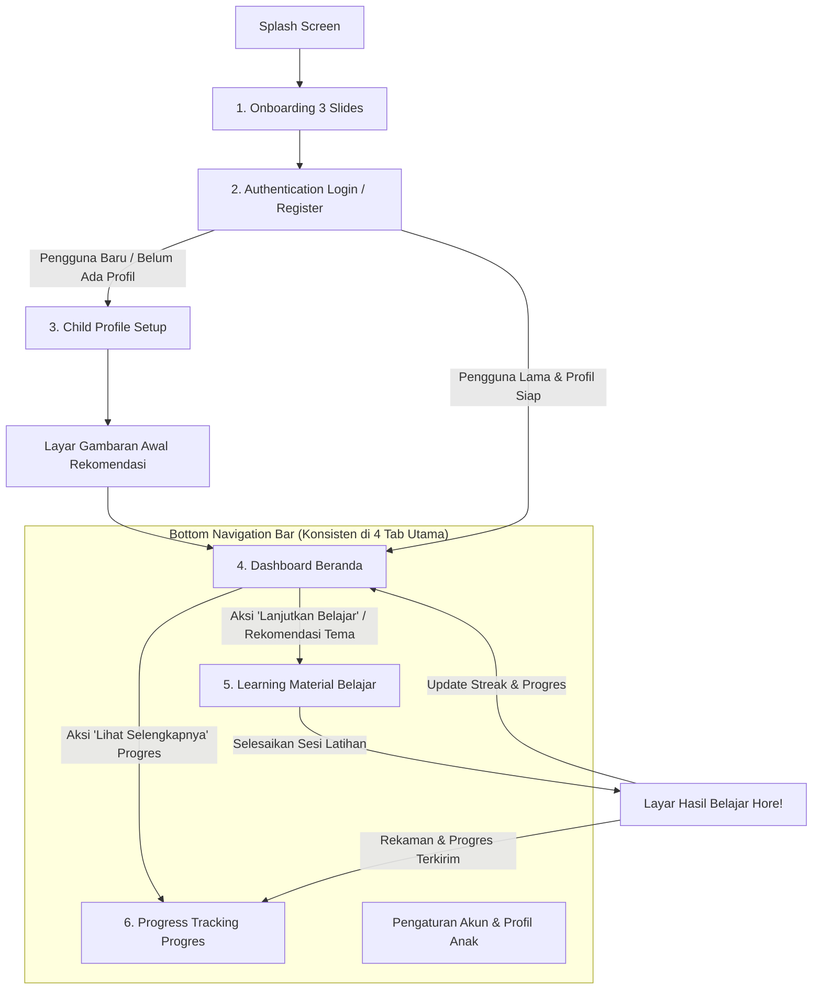

# Product Requirement Document (PRD) – Celoteh

---

## 1. Metadata Proyek
* **Nama Produk:** Celoteh
* **Kategori:** HealthTech / EdTech – Aplikasi Pendamping Stimulasi Bicara Anak
* **Platform:** Mobile Application (Android & iOS)
* **Target Pengguna:** 
  * **Primary User:** Orang tua / pengasuh anak usia 2–6 tahun yang mengalami indikasi keterlambatan bicara (*speech delay*).
  * **Secondary User (End-Beneficiary):** Anak usia dini usia 2–6 tahun (sebagai pengguna sesi interaktif bersama orang tua).
  * **Tertiary User:** Terapis wicara / dokter tumbuh kembang (sebagai penerima dokumentasi/laporan latihan).
* **SDGs Alignment:** SDG 4 (Quality Education) – Sub-target 4.2 (Akses terhadap perkembangan dan pengasuhan anak usia dini berkualitas).
* **Timeline Pengerjaan:** 11 – 19 November 2026
* **Tautan Desain (Figma):** [Link Figma Celoteh](https://figma.com) *(Dapat disesuaikan)*

---

## 2. Product Vision & Overview
**Celoteh** adalah aplikasi *mobile* pendamping stimulasi perkembangan bahasa dan komunikasi anak di rumah yang dirancang terstruktur, menyenangkan, dan terdokumentasi. 

Aplikasi ini menjembatani kesenjangan antara sesi terapi formal dengan rutinitas latihan harian di rumah. Celoteh mengintegrasikan alur holistik:
1. **Onboarding & Auth:** Pengenalan peran orang tua dan pembuatan akun yang aman.
2. **Child Profile:** Asesmen awal non-medis dan personalisasi materi berdasarkan tahap anak.
3. **Dashboard:** Pusat pemantauan konsistensi (streak, level aktif, dan aksi cepat latihan harian).
4. **Learning Materials:** Sesi belajar interaktif 4 tahap (*Kenali → Tirukan → Rekam → Hore!*) berbasis audio-visual, rekaman suara (*voice recording*), dan gamifikasi positif.
5. **Progress Tracking:** Dokumentasi riwayat rekaman suara, log aktivitas harian, catatan observasi orang tua, serta ringkasan perkembangan untuk dikonsultasikan ke terapis.

> **Pernyataan Batasan Medis (Medical Disclaimer):**  
> Celoteh adalah media stimulasi dan pendamping latihan di rumah, **bukan alat diagnosis medis dan bukan pengganti terapi wicara profesional**.

---

## 3. Problem Statement & "How Might We"

### Problem Statement
Berdasarkan riset kebutuhan orang tua dengan anak *speech delay*, ditemukan tiga kendala mendasar:
1. **Bingung Memilih Stimulasi:** Orang tua merasa kewalahan menentukan materi kata, urutan stimulasi, dan cara melatih yang sesuai dengan tingkat kesiapan komunikasi anak.
2. **Latihan di Rumah Tidak Terstruktur & Inkonsisten:** Keterlibatan anak mudah menurun karena metode latihan konvensional membosankan, sedangkan orang tua tidak memiliki panduan harian yang terarah di luar jam terapi.
3. **Perkembangan Tidak Terdokumentasi:** Orang tua kesulitan mengingat dan mengukur progres artikulasi anak dari waktu ke waktu, serta tidak memiliki catatan riwayat latihan yang objektif saat berkonsultasi dengan terapis.

### How Might We (HMW)
> *"Bagaimana kita dapat membantu orang tua melatih stimulasi bicara anak di rumah secara terstruktur, ramah anak, dan terdokumentasi dengan baik tanpa menggantikan peran terapis profesional?"*

---

## 4. Product Goals & Success Metrics (KPI)

| Aspek | Product Goals | Key Metrics / Indikator Keberhasilan |
| :--- | :--- | :--- |
| **Struktur Belajar** | Menyediakan jalur kurikulum bertahap yang adaptif | $\ge 80\%$ pengguna menyelesaikan setidaknya 1 modul sesuai rekomendasi level profil anak. |
| **Engagement Anak** | Menjadikan latihan bicara menyenangkan tanpa intimidasi benar/salah | Rata-rata durasi sesi latihan anak 5–10 menit/hari dengan completion rate sesi $\ge 75\%$. |
| **Konsistensi** | Membangun rutinitas harian orang tua mendampingi anak | *Daily Streak Retention* mencapai minimal 4 hari latihan per minggu. |
| **Dokumentasi** | Menyimpan jejak audio & catatan perkembangan secara terpusat | $100\%$ sesi rekaman tersimpan otomatis di *Progress Tracking* dan dapat diekspor. |

---

## 5. Standarisasi Taksonomi & Struktur Kurikulum
Untuk memastikan konsistensi antarmuka dan terminologi di seluruh modul fitur:

```
[Level Pembelajaran] (Berdasarkan Tahap Perkembangan Komunikasi)
   └── [Tema Pembelajaran] (Konteks Kehidupan Sehari-hari Anak)
          └── [Kosakata / Materi] (Objek/Kata Konkret)
                 └── [Sesi Interaktif 4 Tahap] (Kenali → Tirukan → Rekam → Hore!)
```

* **Level (Tahap Kemampuan):**
  * *Level 1: Eksplorasi Suara & Kata Pertama* (Fokus: Vokal, onomatope, kata benda dasar 1 suku kata/kata tunggal).
  * *Level 2: Kombinasi Kata & Aksi Sehari-hari* (Fokus: Kata kerja sederhana, kata sifat, frasa 2 kata).
  * *Level 3: Kalimat Sederhana & Cerita Ekspresif* (Fokus: Merangkai kebutuhan, menjawab pertanyaan sebab-akibat sederhana).
* **Tema (Kategori):** Ruang Tamu, Hewan Peliharaan, Buah & Makanan, Anggota Keluarga, dsb.
* **Kosakata (Item Belajar):** Satuan kata atau konsep (contoh: Sofa, Meja, Kucing, Ibu).
* **Sesi Belajar (4 Langkah):**
  1. **Kenali:** Visual besar + Audio model pengucapan jelas + Panduan maskot.
  2. **Tirukan:** Prompt verbal interaktif ("Yuk tirukan suara kucing: Meong!").
  3. **Rekam:** Tombol rekam mikrofon + Visualisasi gelombang audio (*voice waveform*) tanpa penalti salah.
  4. **Hore!:** Selebrasi bintang, badge koleksi, update streak, dan pesan afirmasi positif.

---

## 6. Information Architecture (IA) & Global Navigation

Aplikasi Celoteh menggunakan struktur navigasi yang konsisten untuk pengguna terautentikasi melalui **Bottom Navigation Bar (4 Tab Utama)**:



---

## 7. Matriks Keterhubungan & Alur Data Antar Fitur (Cross-Feature Traceability)

Tabel berikut menunjukkan bagaimana setiap fitur saling mengirim dan menerima data (*single source of truth*):

| Modul Fitur | Data Input / Asal Sumber | Data Output / Dampak ke Modul Lain |
| :--- | :--- | :--- |
| **1. Onboarding** | Pengguna pertama kali menginstal aplikasi. | Mengarahkan ke Authentication; flag status onboarding disimpan lokal agar tidak berulang. |
| **2. Authentication** | Input kredensial Orang Tua/Pengasuh; persetujuan kepatuhan privasi data anak. | Mengarahkan *routing*: jika belum ada profil anak $\rightarrow$ Child Profile; jika sudah ada $\rightarrow$ Dashboard. |
| **3. Child Profile** | Nama, usia, tanggal lahir, dan asesmen awal 5 pertanyaan kondisi komunikasi. | Menghasilkan **Rekomendasi Level & Tema Awal** untuk Dashboard dan menandai label *"Rekomendasi"* pada Learning Material. |
| **4. Dashboard** | Mengambil data nama anak & avatar (Child Profile), Streak & Level Progres (Learning Material), serta ringkasan aktivitas (Progress Tracking). | Menyediakan akses cepat (*shortcut*) ke sesi belajar aktif (*Lanjutkan Belajar*) dan navigasi langsung ke Progress Tracking. |
| **5. Learning Material** | Mengambil preferensi tema & rekomendasi level dari Child Profile. | Menyelesaikan sesi belajar akan: <br>1. Mengirim audio latihan ke **Progress Tracking (Riwayat Rekaman)**.<br>2. Menambah log ke **Progress Tracking (Riwayat Aktivitas)**.<br>3. Menambah persentase materi & streak di **Dashboard**. |
| **6. Progress Tracking** | Menerima data log aktivitas, status selesai, dan rekaman suara dari Learning Material; menerima input catatan manual orang tua. | Menyajikan grafik visualisasi perkembangan, evaluasi konsistensi, pemutar rekaman suara, serta ringkasan yang dapat diekspor untuk terapis. |

---

## 8. Prinsip Desain UI/UX Celoteh (Design Principles)

1. **Dual-Audience Friendly (Orang Tua & Anak):**
   * Antarmuka area orang tua (Dashboard, Progress Tracking, Profil) dirancang bersih, tenang, informatif, dan profesional.
   * Antarmuka area sesi belajar (Learning Material) dirancang interaktif, ramah anak, kontras tinggi, elemen visual besar, dan meminimalkan teks panjang.
2. **Positive Reinforcement (Tanpa Stigma Kegagalan):**
   * Tidak ada status "Salah" atau "Gagal" pada rekaman suara. Setiap usaha anak menekan tombol mikrofon dan bersuara diapresiasi ("Hebat, kamu sudah berani mencoba!").
3. **Safety & Privacy First:**
   * Data suara dan profil anak dienkripsi, tidak dipublikasikan ke publik, dan hanya dapat dibagikan atas persetujuan sadar orang tua (*consent-based sharing*).
4. **Effortless Habit Building:**
   * Informasi streak harian dan pengingat lembut disajikan tanpa menciptakan rasa bersalah (*guilt-free gamification*).
