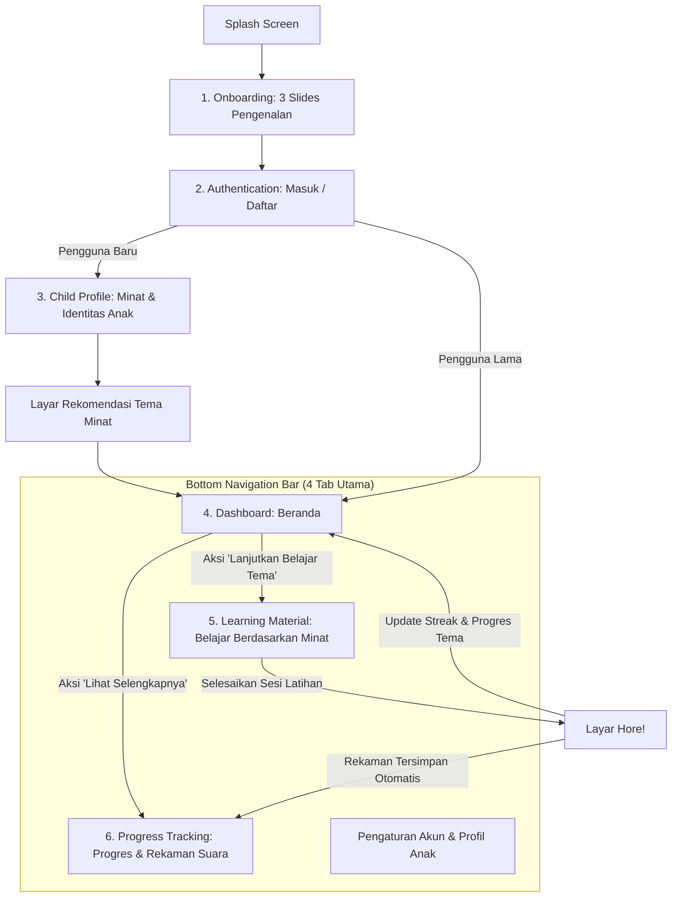

# Product Requirement Document (PRD) – Celoteh

---

## 1. Metadata Proyek
* **Nama Produk:** Celoteh
* **Kategori:** EdTech / HealthTech – Aplikasi Pendamping Stimulasi Bicara Anak Berbasis Minat
* **Platform:** Mobile Application (Android & iOS)
* **Target Pengguna:** 
  * **Primary User:** Orang tua / pengasuh anak usia 2–6 tahun dengan indikasi keterlambatan bicara (*speech delay*).
  * **Secondary User (End-Beneficiary):** Anak usia dini usia 2–6 tahun (sebagai pengguna sesi belajar interaktif bersama orang tua).
  * **Tertiary User:** Terapis wicara (sebagai penerima dokumentasi laporan latihan di rumah).
* **SDGs Alignment:** SDG 4 (Quality Education) – Akses stimulasi perkembangan anak usia dini yang inklusif dan menyenangkan.
* **Timeline:** 11 – 19 November 2026
* **Tautan Desain (Figma):** [Link Figma Celoteh](https://figma.com)

---

## 2. Product Vision & Overview
**Celoteh** adalah aplikasi *mobile* pendamping stimulasi perkembangan bahasa anak di rumah yang dirancang terstruktur, menyenangkan, dan **berbasis minat anak (*interest-driven learning*)**. 

Pendekatan stimulasi bicara anak usia dini terbukti jauh lebih efektif ketika anak diajak belajar melalui topik yang sangat mereka sukai (seperti hewan, kendaraan, makanan favorit, dinosaurus, atau benda di sekitarnya), bukan melalui tingkatan (*level*) yang kaku. 

Celoteh menyatukan alur pengalaman pengguna yang mulus:
1. **Onboarding & Auth:** Pengenalan peran orang tua dan akses akun yang mudah.
2. **Child Profile:** Personalisasi tema belajar berdasarkan minat utama dan kondisi komunikasi anak.
3. **Dashboard:** Pemantauan konsistensi latihan harian (*streak*), progres tema yang sedang dipelajari, dan akses cepat latihan.
4. **Learning Materials:** Sesi belajar interaktif 4 tahap (*Kenali → Tirukan → Rekam → Hore!*) yang menyenangkan dan mengapresiasi setiap suara anak tanpa rasa takut salah.
5. **Progress Tracking:** Pemantauan penguasaan kata per tema minat, arsip rekaman suara anak, catatan observasi harian orang tua, serta ringkasan yang dapat dibagikan kepada terapis wicara.

> **Catatan:** Celoteh berfungsi sebagai sarana stimulasi di rumah, bukan alat diagnosis medis dan bukan pengganti sesi terapi wicara profesional.

---

## 3. Problem Statement & "How Might We"

### Problem Statement
1. **Anak Cepat Bosan & Tidak Termotivasi:** Metode latihan bicara konvensional yang kaku membuat anak enggan bersuara. Anak membutuhkan stimulasi melalui objek dan tema yang benar-benar memancing rasa ingin tahu mereka.
2. **Orang Tua Bingung Memilih Materi:** Orang tua kesulitan menentukan kata atau topik apa yang tepat dan relevan untuk dilatihkan di rumah setiap hari.
3. **Dokumentasi Perkembangan Tercecer:** Orang tua tidak memiliki arsip rekaman suara anak untuk melihat perkembangan artikulasi dari waktu ke waktu dan sulit menceritakan kemajuan saat berkonsultasi dengan terapis.

### How Might We (HMW)
> *"Bagaimana kita dapat membantu orang tua melatih stimulasi bicara anak di rumah melalui tema-tema yang disukai anak secara terstruktur, menyenangkan, dan terdokumentasi dengan baik?"*

---

## 4. Product Goals & Indikator Keberhasilan (UX Metrics)

| Aspek | Product Goals | UX Metrics |
| :--- | :--- | :--- |
| **Pendekatan Belajar** | Mengarahkan stimulasi sesuai minat dan antusiasme anak | $\ge 85\%$ sesi latihan dimulai dari tema yang dipilih atau disukai anak. |
| **Engagement Anak** | Menjadikan latihan bicara bebas stres (*zero-penalty*) | Rata-rata durasi latihan 5–10 menit per hari dengan completion rate $\ge 80\%$. |
| **Konsistensi Orang Tua** | Membentuk kebiasaan stimulasi harian di rumah | Mempertahankan *Daily Streak* minimal 4 hari latihan per minggu. |
| **Dokumentasi** | Menyimpan rekaman suara dan catatan perkembangan anak | $100\%$ rekaman suara anak tersimpan rapi per tema dan dapat didengarkan kembali. |

---

## 5. Struktur Kurikulum Berbasis Minat (*Interest-Based Curriculum*)

Celoteh **tidak menggunakan sistem penjenjangan level yang mengunci materi**, melainkan mengelompokkan kosakata ke dalam **Tema-Tema Minat Kontekstual**:

```
[Tema Minat Anak] (Pilihan Topik: Hewan, Buah, Kendaraan, Dinosaurus, dll.)
   └── [Kosakata / Materi] (Objek/Kata Konkret yang Bermakna)
          └── [Sesi Interaktif 4 Tahap] (Kenali → Tirukan → Rekam → Hore!)
```

* **Fleksibilitas Minat:** Orang tua dan anak bebas memilih tema mana pun yang ingin dieksplorasi hari ini, dengan panduan rekomendasi tema favorit dari profil anak.
* **Tema Pembelajaran:** 
  * 🐶 *Hewan Peliharaan* (Kucing, Kelinci, Ayam, Ikan, Burung)
  * 🍎 *Buah & Makanan* (Apel, Pisang, Jeruk, Nasi, Susu, Roti)
  * 🚗 *Kendaraan & Transportasi* (Mobil, Motor, Kereta, Pesawat, Sepeda)
  * 🛋️ *Benda di Rumah* (Sofa, Meja, Tempat Tidur, Lampu, Pintu)
  * 👨‍👩‍👧 *Keluarga & Diri Sendiri* (Ibu, Ayah, Kakak, Adik, Baju, Sepatu)
  * 🦖 *Dunia Dinosaurus & Alam* (Dino, Pohon, Bunga, Bintang, Air)
* **Sesi Belajar (4 Langkah):**
  1. **Kenali:** Mengenal objek lewat ilustrasi ceria, teks nama objek, dan audio pengucapan jernih.
  2. **Tirukan:** Maskot mengajak anak menirukan suara atau kata dengan ramah.
  3. **Rekam:** Tombol mikrofon interaktif dan visualisasi gelombang suara. Menghargai setiap usaha bersuara tanpa vonis salah.
  4. **Hore!:** Selebrasi bintang, lencana tema, pertambahan streak harian, dan afirmasi positif.

---

## 6. Information Architecture & Navigasi Global

Aplikasi menggunakan **Bottom Navigation Bar (4 Tab Utama)** untuk kemudahan eksplorasi:



---

## 7. Matriks Keterhubungan Antar Fitur (Cross-Feature Traceability)

| Modul Fitur | Data Input / Asal | Peran & Dampak ke Modul Lain |
| :--- | :--- | :--- |
| **1. Onboarding** | Pengguna baru membuka aplikasi. | Mengenalkan manfaat belajar berbasis suara & minat; mengarahkan ke Authentication. |
| **2. Authentication** | Kredensial orang tua (Email & Password). | Mengarahkan alur: pengguna baru ke Child Profile, pengguna lama langsung ke Dashboard. |
| **3. Child Profile** | Nama anak, usia, dan **pilihan tema minat favorit** serta kondisi awal bicara. | Menghasilkan **Rekomendasi Tema Utama** di Dashboard dan menandai label *"Favorit Kayla"* di Learning Material. |
| **4. Dashboard** | Data anak aktif (Child Profile), streak latihan & progres kata per tema (Learning Material), dan rekaman terbaru (Progress Tracking). | Menyediakan tombol cepat *"Lanjutkan Belajar [Tema Terakhir]"* dan ringkasan kosakata yang sudah dipelajari. |
| **5. Learning Material** | Menampilkan katalog tema belajar yang disesuaikan dengan minat anak. | Setiap kata yang selesai dipelajari akan: <br>1. Mengirim audio latihan ke **Progress Tracking (Arsip Suara)**.<br>2. Menambah log ke **Progress Tracking (Riwayat Aktivitas)**.<br>3. Memperbarui progres tema dan streak di **Dashboard**. |
| **6. Progress Tracking** | Menerima arsip audio rekaman dan log kata selesai dari Learning Material; menerima catatan manual orang tua. | Menampilkan capaian kata per tema minat, pemutar rekaman suara, log aktivitas harian, serta fitur **Ekspor Ringkasan Latihan** untuk terapis. |

---

## 8. Prinsip Desain UI/UX Celoteh
1. **Interest-First Approach:** Mengutamakan topik yang disukai anak agar proses stimulasi terjadi secara alami dan tanpa paksaan.
2. **Dual Experience Mode:**
   * *Mode Anak (Sesi Belajar):* Tombol besar, visual cerah, animasi maskot bersahabat, tanpa beban membaca teks panjang.
   * *Mode Orang Tua (Dashboard & Tracking):* Bersih, informatif, menyajikan data perkembangan yang jelas dan mudah dipahami.
3. **Zero-Penalty Reinforcement:** Tidak ada skor gagal atau pesan salah; setiap percobaan anak menekan mikrofon dan mengeluarkan suara diapresiasi dengan bintang dan konfeti.
